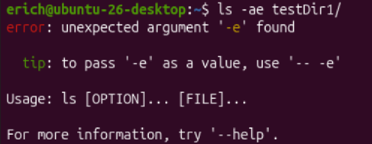
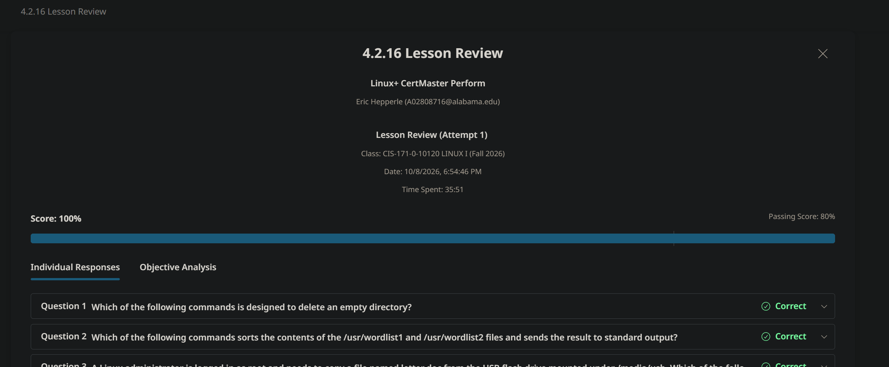

<!-- Custom stylesheet -->
<link rel="stylesheet" href="../../_css/main.css">

<!-- Site logo -->


> [🏚️ README](../../../README.md) | [📁 Courses](../../index.md) | [📚 Vocabulary](../../Vocabulary.md) | [🗓️ Assignments Schedule](../Assignments_Schedule.md) | [🔖 Bookmark](#bookmark)

### Notes:
# CIS 171 - Linux I: CHAPTER 4
- https://labsimapp.testout.com/v6_0_743/index.html/productviewer/1238/4.1.5/7be7e484-b259-49bb-adae-583042921e67?nonce=jZvvsSp8zxNdKn1VebvATfeyBEN5XCG5

> The following are my notes on the **CompTIA: Linux+ CertMaster Perform** V8 learning platform course
> The represent sparse notes thrown together, not perfectly organizized while cramming to complete assignments
> It seems it will be better to complete the assignments and then go take notes later based on the format the labs are given in (it gives you the instructions and)


---

## 🟣 4.2.16 LESSON REVIEW

`ls -ae`?



---

| Directory | Intended purpose                                                                         |
| --------- | ---------------------------------------------------------------------------------------- |
| /media    | Mount points for removable media, such as USB flash drives.                              |
| /mnt      | A location for temporarily mounting a filesystem, commonly during administrative work.   |
| /root     | The root user’s home directory—not the same thing as /, the filesystem’s root directory. |

---

An application named ABCD is generating system errors when it starts.

Which of the following commands searches the system message log file for these errors?

answer

A
grep ABCD /var/log/messages  #MY_CHOICE - grep is the only search utility choice


B
top /var/log/ABCD.log


C
tail -n25 /var/log/ABCD.log


D
tail -n25 /var/log/messages


---

Which of the following commands displays an expanded listing that includes the owner and size of all the files in the /etc directory?

answer

A
dir -al /etc


B
ls -ae /etc


C
ls -al /etc  #MY_CHOICE


D
ld -ae /etc

---

As a Linux administrator, you need to create the directory /var/oracle/database/9i. Only the directory /var currently exists. The current working directory is the root of the filesystem.

Which of the following commands will create the directory path?

answer

A
mkd /var/oracle/database/9i


B
md -path /var/oracle/database/9i


C
mkdir -p /var/oracle/database/9i  #MY_CHOICE


D
mkdir /var/oracle/database/9i


> ## ✅ Correct: **C**
> 
> ```bash
> mkdir -p /var/oracle/database/9i
> ```
> 
> The `-p` option means “parents”: create any missing parent directories along with the requested directory. [lists.gnu](https://lists.gnu.org/archive/html/coreutils/2013-04/msg00076.html)
> 
> Since `/var` already exists, this creates:
> 
> ```text
> /var/oracle
> /var/oracle/database
> /var/oracle/database/9i
> ```
> 
> ## 🔍 Why not the others?
> 
> - A and B: `mkd` and `md -path` are not the standard Linux commands for this task.
> - D: Without `-p`, `mkdir` fails because the parent directory `/var/oracle/database` does not exist. [docs](https://docs.rs/tokio/latest/tokio/fs/fn.create_dir.html)
> 
> The current working directory is irrelevant here: the leading `/` makes this an absolute path, starting at the filesystem root.

---


A bash script developer is trying to debug a shell script named myscript. Which of the following commands would record the output of the script in a testfile.txt text file?

answer

A
echo myscript >> testfile.txt


B
myscript | echo | testfile.txt


C
myscript | testfile.txt


D
myscript >> testfile.txt #MY_CHOICE, but not confident

> ## ✅ Correct: **D**
> 
> ```bash
> myscript >> testfile.txt
> ```
> 
> This runs `myscript` and appends its standard output to `testfile.txt`, creating the file if necessary. Existing contents remain intact. [gnu](https://www.gnu.org/software/bash/manual/html_node/Redirections.html)
> 
> ## 🔍 Why the others fail
> 
> - A: `echo myscript` prints the literal text `myscript`; it does not execute the script.
> - B and C: A pipe sends output to another command—not directly into a file. They attempt to execute `testfile.txt`. [gnu](https://www.gnu.org/software/bash/manual/bash.html)
> 
> ## 🛠️ Debugging caveat
> 
> D captures standard output, but not error messages. To append both standard output and standard error:
> 
> ```bash
> myscript >> testfile.txt 2>&1
> ```
> 
> `2>&1` sends standard error to the same destination as standard output. [gnu](https://www.gnu.org/software/bash/manual/html_node/Redirections.html)

---

Which of the following utilities will substitute an existing string with a new string within a file?

answer

A
grep


B
sed  #MY_CHOICE


C
fgrep


D
egrep

> ## ✅ Correct: **B — `sed`**
> 
> `sed` is a stream editor that can substitute existing text with new text. The `grep` family searches for matching text rather than replacing it. [redhat](https://www.redhat.com/en/blog/manipulating-text-sed)
> 
> ## 🛠️ Example
> 
> ```bash
> sed 's/old/new/g' file.txt
> ```
> 
> - `s`: substitute.
> - `old`: pattern to find.
> - `new`: replacement text.
> - `g`: replace every match on each line, rather than only the first. [linuxize](https://linuxize.com/post/how-to-use-sed-to-find-and-replace-string-in-files/)
> 
> Important distinction: that command displays the modified contents without changing the original file. To edit the file itself and keep a backup:
> 
> ```bash
> sed -i.bak 's/old/new/g' file.txt
> ```
> 
> This updates `file.txt` and preserves the original as `file.txt.bak`. [linuxize](https://linuxize.com/post/how-to-use-sed-to-find-and-replace-string-in-files/)


#PROOF



---

# 🟣 

---

# 🟣 


--- --- --- END  --- --- ---


