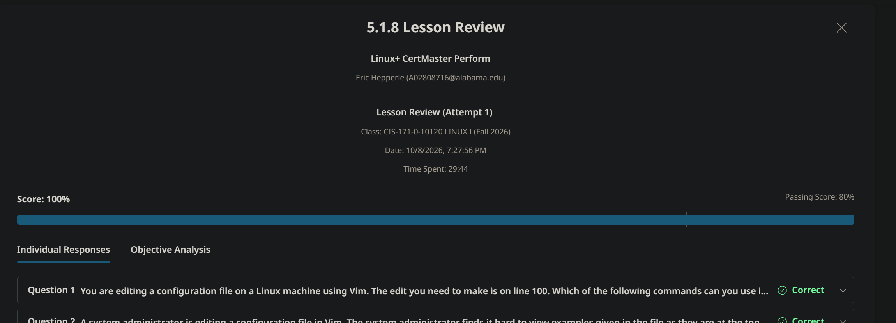
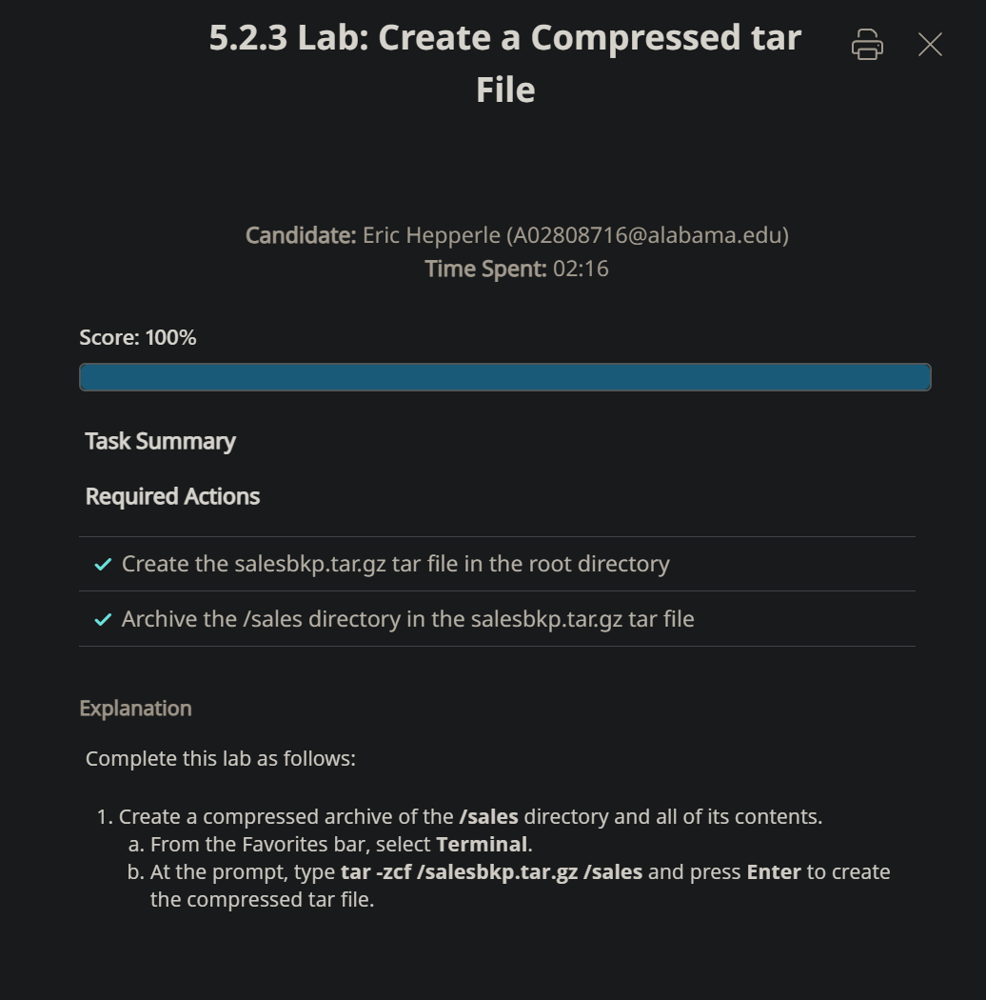
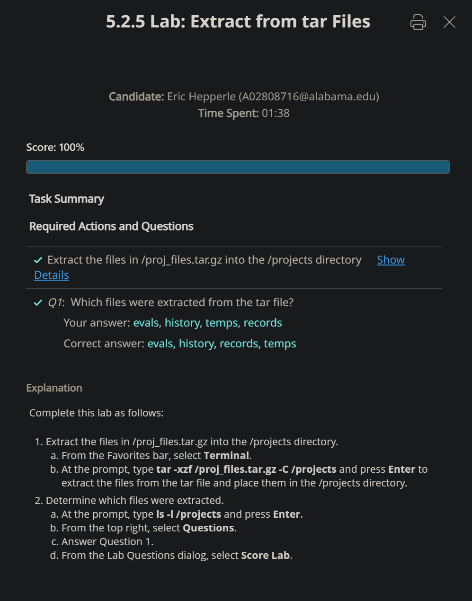
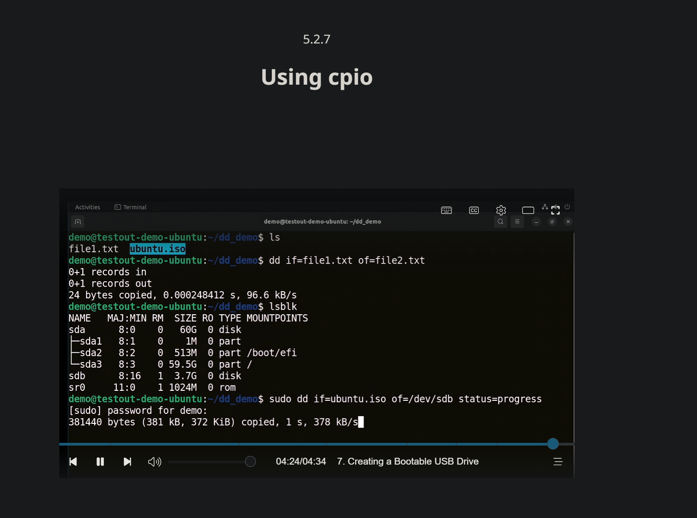

<!-- Custom stylesheet -->
<link rel="stylesheet" href="../../_css/main.css">

<!-- Site logo -->


> [🏚️ README](../../../README.md) | [📁 Courses](../../index.md) | [📚 Vocabulary](../../Vocabulary.md) | [🗓️ Assignments Schedule](../Assignments_Schedule.md) | [🔖 Bookmark](#bookmark)

### Notes:
# CIS 171 - Linux I: CHAPTER 5
- https://labsimapp.testout.com/v6_0_743/index.html/productviewer/1238/4.1.5/7be7e484-b259-49bb-adae-583042921e67?nonce=jZvvsSp8zxNdKn1VebvATfeyBEN5XCG5

> The following are my notes on the **CompTIA: Linux+ CertMaster Perform** V8 learning platform course
> The represent sparse notes thrown together, not perfectly organizized while cramming to complete assignments
> It seems it will be better to complete the assignments and then go take notes later based on the format the labs are given in (it gives you the instructions and)


---

## 🟣 5.1.8 LESSON REVIEW

You are editing a configuration file on a Linux machine using Vim. The edit you need to make is on line 100. Which of the following commands can you use in Command mode to quickly jump to line 100?

answer

A
Ctrl+W


B
100G  #MY_CHOICE


C
:wq


D
gg100

---


A system administrator is editing a configuration file in Vim. The system administrator finds it hard to view examples given in the file as they are at the top of the file, while the settings that need editing are near the bottom of the file. What Vim keystroke would call the application to split the screen into two horizontal windows?

answer

A
Ctrl+W, then v


B
Ctrl+W, then h


C
Ctrl+W, then w


D
Ctrl+W, then s   #MY_CHOICE


> # 🪟 Vim Horizontal Splits: Quick Reference
> 
> A **horizontal** split creates two stacked windows. Both can show the same file at different positions—for example, reference examples at the top and configuration settings near the bottom.
> 
> ## ⌨️ Create a Horizontal Split
> 
> First, press `Esc` to enter Normal mode.
> 
> ### Using a keyboard shortcut
> 
> Press `Ctrl+w`, release, then press lowercase `s`.
> 
> ### Using a command
> 
> Type either command and press Enter:
> 
> ```vim
> :split
> ```
> 
> ```vim
> :sp
> ```
> 
> Both split the current window and display the same file in the new window.
> 
> To open a different file in the new window:
> 
> ```vim
> :sp filename.txt
> ```
> 
> ## 🧭 Navigate Between Windows
> 
> Use these shortcuts in Normal mode. Press `Ctrl+w`, release, then press the indicated key.
> 
> | Action | Shortcut |
> |---|---|
> | Move to the window below | `Ctrl+w`, then `j` or `↓` |
> | Move to the window above | `Ctrl+w`, then `k` or `↑` |
> | Move to the window on the left | `Ctrl+w`, then `h` or `←` |
> | Move to the window on the right | `Ctrl+w`, then `l` or `→` |
> | Cycle to the next window | `Ctrl+w`, then `w` |
> 
> Each window maintains its own cursor position and view. If two windows display the same file, edits in either window affect that same file—not separate copies.
> 
> ## 📏 Resize Windows
> 
> | Action | Shortcut |
> |---|---|
> | Increase height by one line | `Ctrl+w`, then `+` |
> | Decrease height by one line | `Ctrl+w`, then `-` |
> | Increase height by five lines | `Ctrl+w`, then `5`, then `+` |
> | Decrease height by five lines | `Ctrl+w`, then `5`, then `-` |
> 
> Replace `5` with the desired number of lines. The number specifies how much to change the height, not the final height.
> 
> ## 🚪 Close a Window
> 
> | Action | Command or shortcut |
> |---|---|
> | Close the current window; exit Vim if it is the last editing window | `:q`, then Enter |
> | Close the current window without closing the only remaining window | `Ctrl+w`, then `c` |
> 
> Neither operation automatically saves changes. Vim may refuse to close a window if doing so would abandon unsaved changes.
> 
> To save the current file without closing its window:
> 
> ```vim
> :w
> ```
> 
> ## 📍 Choose Where New Splits Open
> 
> By default, a new horizontal split opens above the current window.
> 
> To open new horizontal splits below the current window for the current session:
> 
> ```vim
> :set splitbelow
> ```
> 
> To make this preference persistent, add the following line to `~/.vimrc`:
> 
> ```vim
> set splitbelow
> ```
> 
> ## 💡 Example: Reference Above, Settings Below
> 
> 1. Open the configuration file in Vim.
> 2. Press `Esc`, then `Ctrl+w`, then `s` to split the window.
> 3. In the active window, press `gg` to go to the first line.
> 4. Press `Ctrl+w`, then `j` to move to the lower window.
> 5. Press `G` to go to the last line.
> 6. Navigate to the setting you need and edit it while keeping the examples visible above.

---

> - caret symbol (^) is a classic shorthand notation representing the Ctrl (Control) key in keyboard shortcuts and technical documentation.

---

> ## ✅ Correct answer: **C** — and your pushback is valid
> 
> `Alt+U` does undo the last action in nano. However, that shortcut is not offered among the answers. `Ctrl+U` is also a valid way to recover the line because `Ctrl+K` cuts it into nano’s cutbuffer rather than simply discarding it. [nano-editor](https://www.nano-editor.org/dist/latest/cheatsheet.html)
> 
> ## 🧠 Undo versus “uncut”
> 
> | Shortcut | What it does |
> |---|---|
> | `Ctrl+K` | Cuts the current line into nano’s cutbuffer. |
> | `Ctrl+U` | Pastes—or “uncuts”—the cutbuffer contents at the current cursor position. |
> | `Alt+U` | Undoes the last action. |
> | `Alt+E` | Redoes the last undone action. |
> 
> These are nano’s documented shortcuts. [nano-editor](https://www.nano-editor.org/dist/latest/cheatsheet.html)
> 
> Immediately after accidentally cutting the line, either `Alt+U` or `Ctrl+U` can restore it. The important difference: if you move the cursor first, `Ctrl+U` pastes at the new location; undo reverses the original edit. [cs.emory](https://www.cs.emory.edu/~cheung/Courses/RemoteAccess/Nano/nano.html)
> 
> ## ⚠️ Why the other answers fail
> 
> - A: `Alt+\` moves to the beginning of the file; it does not undo.
> - B: `Ctrl+^` marks text and `Alt+^` copies text; neither restores an already-cut line.
> - D: Retyping is unnecessary because nano retained the cut text. [nano-editor](https://www.nano-editor.org/dist/latest/cheatsheet.html)
> 
> So your memory is correct—just call `Alt+U` nano’s undo shortcut, not a universal Linux undo shortcut.


---

A user is editing a text file using Nano. The user needs to highlight a line of text to copy and paste it somewhere else in the file. After figuring out how to start the highlighting of text using Ctrl+^, the user then moves the cursor to the last character of the selected text. What key combination would copy the highlighted text?

answer

A
Alt + \


B
Ctrl + p


C
Ctrl + x


D
Alt + ^

---

What happens if you run the gedit command without specifying a file name?

answer

A
The last edited file will be opened.


B
All available files in the current directory will be listed.


C
An error message is displayed and the program is closed.


D
A new blank file will be opened.   #MY_CHOICE


---


You are working as the a junior network technician. The network administrator has asked you to configure a Linux machine for remote administration using SSH. To configure the SSH service and adjust its settings, which of the following configuration files should you edit?

answer

A
/etc/ssh/sshd_config  #MY_CHOICE


B
/etc/hosts


C
/etc/passwd


D
/etc/network/interfaces


> ## ✅ Correct answer: **A — `/etc/ssh/sshd_config`**
> 
> This file configures the OpenSSH server service, `sshd`. It controls settings such as the listening port, permitted authentication methods, and whether root can log in remotely. [man7](https://man7.org/linux/man-pages/man5/sshd_config.5.html)
> 
> ## 🌐 Why not the network configuration file?
> 
> You’re right that SSH involves networking and security. But the distinction is between configuring the machine’s network connection and configuring a service that uses that connection:
> 
> | File | What it configures |
> |---|---|
> | `/etc/ssh/sshd_config` | SSH server behavior: remote-login and authentication settings.  [man7](https://man7.org/linux/man-pages/man5/sshd_config.5.html) |
> | `/etc/network/interfaces` | Network interfaces: IP addressing, DHCP, and routing on systems using this configuration method.  [wiki.debian](https://wiki.debian.org/NetworkConfiguration) |
> 
> For example:
> 
> - “Give this machine a static IP address” → network-interface configuration. [wiki.debian](https://wiki.debian.org/NetworkConfiguration)
> - “Allow SSH logins using public keys instead of passwords” → SSH server configuration. [man7](https://man7.org/linux/man-pages/man5/sshd_config.5.html)
> 
> SSH uses the network, but its service settings belong in its own configuration file.
> 
> ## 🧠 Useful filename distinction
> 
> - `sshd_config`: configures the SSH server—the machine accepting connections.
> - `ssh_config`: configures the SSH client—the program initiating connections.
> 
> The `d` in `sshd` means daemon: the background service accepting SSH connections. For this question, “configure the SSH service” points directly to `sshd_config`. [ssh](https://www.ssh.com/academy/ssh/sshd_config)

#PROOF




---


# 🟣 5.2.3 LAB: Create compressed tar file

> - tar -zcf: zip the file, create the archive, and the filename

#PROOF



---

# 🟣 5.2.5 LAB: Extract from tar files

> - tar -xzf: extract, unzip, and the filename
> - C = the directory wher ethe command should be performed

#PROOF



---

# 🟣 5.2.7 VIDEO: Usign cpio



---

# 🟣 


---

# 🟣 

---

# 🟣 


---

# 🟣 

---

# 🟣 


---

# 🟣 

---

# 🟣 


---

# 🟣 

---

# 🟣 


--- --- --- END  --- --- ---


