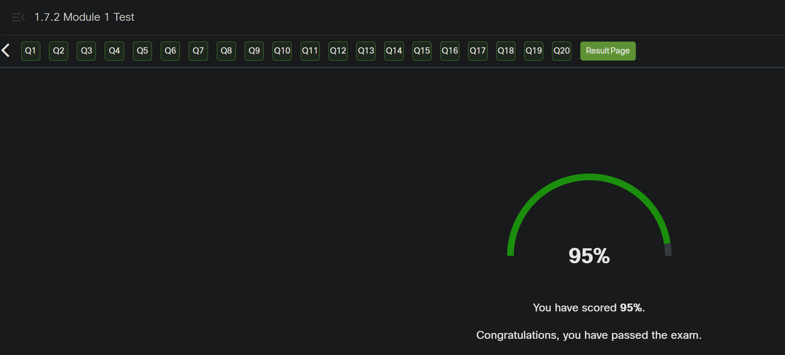
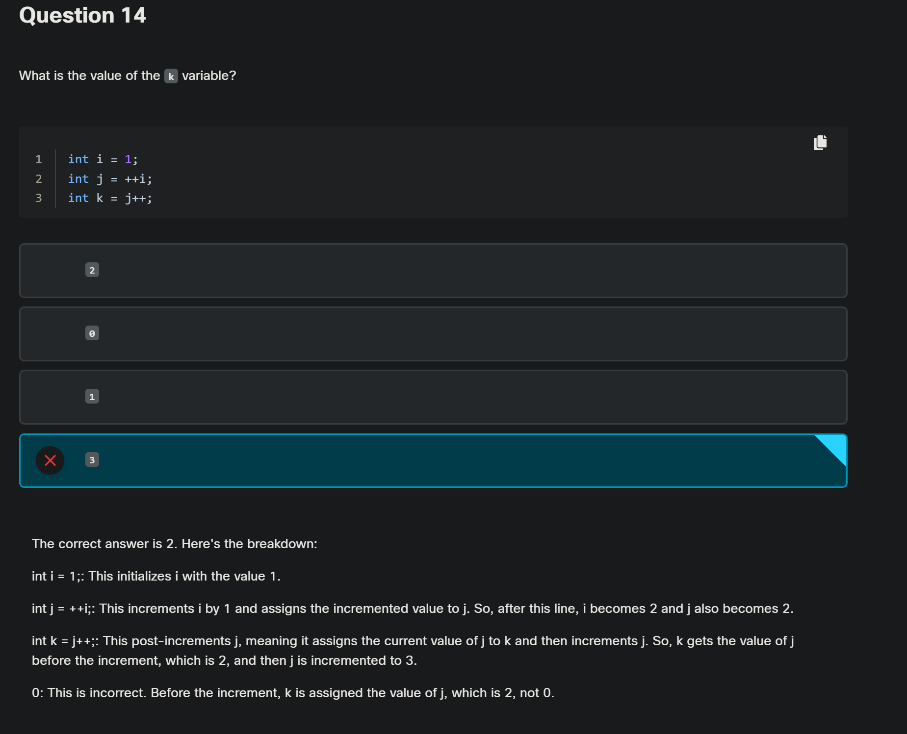
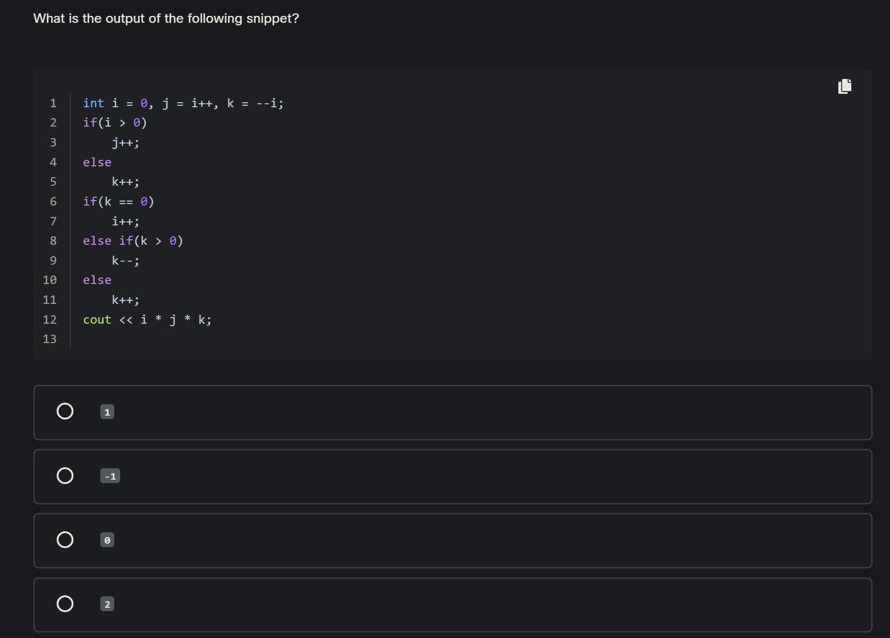

<!-- 🔗 Custom Stylesheet -->
<link rel="stylesheet" href="../../../_css/main.css">

<!-- 🖼️ Site Logo -->


### NOTES: SCRATCH — Mixed Weeks (CIS 251 - C++ Programming)

# 🧩 CPPE1: Module 1:


## 🟣 1.7.2 Module 1 Test

#PROOF





> Question 14
> 
> 2   1 of 4
> 
> 0   2 of 4
> 
> 1   3 of 4
> 
> 3   4 of 4
> 
> The correct answer is 2. Here's the breakdown:
> 
> int i = 1;: This initializes i with the value 1.
> 
> int j = ++i;: This increments i by 1 and assigns the incremented value to j. So, after this line, i becomes 2 and j also becomes 2.
> 
> int k = j++;: This post-increments j, meaning it assigns the current value of j to k and then increments j. So, k gets the value of j before the increment, which is 2, and then j is incremented to 3.
> 
> 0: This is incorrect. Before the increment, k is assigned the value of j, which is 2, not 0.
> 
> 1: This is incorrect. k is assigned the value of j before the increment, which is 2, not 1.
> 
> 3: This is incorrect. k is assigned the value of j before the increment, which is 2, not 3.


---

# 🧩 CPPE1: Module 2:

## 🟣 2.8.1 Structures - Why do we need them?

Before we start going on about structures, we need to tell you about a completely new type, named **string**. For now, we’re not going to tell you any more than what we use it for and how we declare variables of this type. We promise we’ll give you more details in a separate section devoted exclusively to strings, and we’ll show you how to manipulate them and how to enjoy using them.

To be honest, a string is little more than a type, and all we want to tell you at this point is that variables of type `string` are able to store strings of characters, like surnames, family names, street names and all other names you can think of, including R2D2.

Variables of type string may be assigned with the same operators as any other variable we’ve previously encountered. For example, if we want to store the name of our favourite dish in a string variable, we do it in the following way:


```cpp
string dish_to_order = "pizza";
```

Imagine that we, the developers, have the following job to do: we’re obliged to design a data structure that can store information about students attending our course. It needs to store the name of each student, the time spent on studying the chapters and the number of the last completed chapter. We know that the total number of all students will not exceed 100,000. We also know that most names are rarely longer than 25 characters and this leads us to write the following declaration:


```cpp
char student_name[100000][26];
```

The array allows us to store 100,000 names of up to 25 characters. Wait a minute – you might say – if it’s 25 characters, why did we write “26” in the declaration? We just reserved one more character for the terminating (closing) character, that’s all.

Let's try to manipulate that array. For example, suppose that the first registered student was Mr. Bond (James Bond). Let’s store the information in our array:


```cpp
strcpy(student_name[0],"Bond");
```

The time spent on the site will be stored as a float. This is not particularly convenient, but we can certainly handle it. The number of hours will be represented as a decimal fraction. This leads us directly to the following statement.


```cpp
float student_time[100000];
```

We know that Mr. Bond spent three hours and thirty minutes studying our course. We’ll denote it in the following way:


```cpp
student_time[0] = 3.5;
```

**Note:** 3h30m = three and a half hours, thus 3.5.

The main issue here is that the data concerning the same object (a student) is **dispersed between three variables**, although it should logically exist as a consolidated unit. Handling multiple arrays is cumbersome and error-prone, and when life forces us to collect additional information (e.g. e-mail address) we’re going to need to declare another array and make a lot of other changes throughout the program. We don’t like it, and you can be sure you won't like it either.

We already know what an array is. The array is an aggregate of elements. The elements are numbered and are of the same type. Can we use **an aggregate whose elements could be of different types**? Could they be identified by names, not by numbers? And is it a good idea?

Yes, it's a great idea! This magical aggregate is called a **structure**.

A structure contains **any number of elements of any type**. Each of these elements is called a **field**. Each field is identified by its name, not by its number. Obviously, the field names must be **unique** and ***cannot be doubled within a single structure***. We’ll show you how to declare a structure suitable for our needs and we’ll explain its meaning.

You can see the declaration of the structure in the editor:

```cpp
struct STUDENT {
  string name;
  float time;
  int recent_chapter;
};
```

- the declaration of the structure always starts with the keyword `struct`;
- there is a so-called struct tag after the keyword (`STUDENT` in this case); it's the name of the structure itself; there is a widely accepted custom of composing structure tags with capital letters simply to distinguish them from ordinary variables
- here comes the opening curly bracket – a sign that the field declaration begins at this point;
- our structure has three fields: the first is a string and is called `name`; the second is a float and is called `time`; the third is an int and it’s called `recent_chapter`
- the declaration ends with the closing curly bracket followed by a semicolon.

We want to emphasize that the previous declaration doesn't create a variable, but only describes the structure we’re going to use in our program. If we want to declare a variable as a structure, we can do it in one of two possible ways:


```cpp
struct STUDENT stdnt;
STUDENT stdnt2;
```

This declaration sets up two variables (structured variables) named `stdnt` and `stdnt2` respectively. The variables are of type `struct STUDENT` or just `STUDENT` (notice, that the structure declaration creates a new type name). We know that this variable consists of three named fields, but we don’t yet know how to access them.

As the C++ language offers a specialized indexing operator `[]` for arrays, it also gives us a so-called **selection operator** designed for structures and is denoted as a single character `.` (dot).

The priority of the selection operator is very high, equal to the priority of the `[]` operator.

This is a binary operator. Its left argument **must identify the structure** while the right argument must be the **name of the field** known in this structure.

The result of this operator is the selected field of structure, and therefore the expression containing this operator is sometimes called a **selector**.

This means that the selector here:


```cpp
stdnt.time
```

results in the selection of a field named `time`. The type of this expression is the type of the selected field and this expression is an l-value.

Consequently, you can use both of these selectors:


```cppstdnt.time = 1.5;
```

and

```cpp
float t;

t = stdnt.time;
```

Virtually any data could be used as a structure's field: scalars (including pointers), arrays and also almost all of the structures. We say “almost” because a **structure cannot be a field of itself**.

Structures can be aggregated inside an array, so if we want to declare an array consisting of `STUDENT` structures, we do it in this way:


```cpp
struct STUDENT stdnt[100000];
```

Access to the selected fields requires two subsequent operations:

- in the first step, the `[]` operator indexes the array in order to access the structure we need;
- in the second step, the selection operator selects the desired field.

This means that if we want to select the `time` field of the fourth `stdnts`' element, we'll write it like this:

```cpp
stdnts[3].time
```

We’ve collected all these assignments which have been performed for the three separate arrays. Analyze them carefully:


```cpp
stndts[0].name = "Bond";
stndts[0].time = 3.5;
stdnts[0].recent_chapter = 4;
```


## 🟣 2.8.2 Declaring the structures

For the purposes of further considerations we’ll use a simple structure designed to store the date. It’s equipped with three fields, each of type `int`, named `year`, `month` and `day`, which clearly denote their role and purpose.

The first possible way of declaring the structure is in the editor:


```cppplay_arrow
sync
download
light_mode
dark_mode

Console 
terminal

sync

Of course, we can write this declaration much more compactly:


```cpp
struct DATE {
    int year, month, day;
};

Both variants are equivalent.

That declaration doesn't create any new variables, but only announces to the compiler our intention to use this structure tag to declare new variables. The new variable would be declared, for example, in this way:


```cpp
DATE DateOfBirth;

We can use it to store Harry Potter's date of birth:


```cpp
DateOfBirth.year = 1980;
DateOfBirth.month = 7;
DateOfBirth.day = 31;

We can also use the structure tag to declare an array of structures:


```cpp
DATE visits[100];

Accessing a single structure stored in the array is easy. If we want to modify the data of the first visit, we do this:


```cpp
Visits[0].year = 2012;
Visits[0].month = 1;
Visits[0].day =  1;

It’s also possible to kill two birds with one stone by defining the structure tag and declaring any number of variables simultaneously in the same statement, like this:


```cpp
struct DATE {
     int year, month, day;
} DateOfBirth, Visits[100];

DATE current_date;

We can also omit the tag and declare the variables only:


```cpp
struct {
  int year, month, day;
}
the_date_of_the_end_of_the_world;

In this case, however, determining the type of the variable the_date_of_the_end_of_the_world (e.g. if we want to use it with the sizeof operator) becomes troublesome. Without a tag it has to be denoted as:


```cpp
sizeof(struct {int year, month, day;})

We find it too complex and unreadable, compared to sizeof(struct DATE).

---

## 🟣 2.10.2 Module 2 Test



```cpp
int i = 0, j = i++, k = --i;
if(i > 0)
    j++;
else
    k++;
if(k == 0)
    i++;
else if(k > 0)
    k--;
else
    k++;
cout << i * j * k;
```

---


```cpp> ## ✅ Output
> 
> ```text
> 1000000000000000.000000
> ```
> 
> ## 🧠 Plain English
> 
> - `1e15` means \(1 \times 10^{15}\), or `1000000000000000`.
> - `1e-15` means \(0.000000000000001\).
> - `fixed` tells `cout` to print the number in normal decimal form with **6 digits after the decimal point** by default. [en.cppreference](https://en.cppreference.com/cpp/io/ios_base/precision)
> 
> So `big + small` is essentially:
> 
> ```text
> 1000000000000000.000000000000001
> ```
> 
> But `fixed` with default precision shows only 6 decimal places, so the tiny `0.000000000000001` is rounded away in the displayed result. [cplusplus](https://cplusplus.com/reference/ios/fixed/)
> 
> ## ⚠️ Key idea
> 
> A `double` has limited precision. When you add an extremely tiny number to an extremely large number, the tiny part may not show up in the output unless you increase precision with `setprecision()`. [boost](https://www.boost.org/doc/libs/1_83_0/libs/multiprecision/doc/html/boost_multiprecision/tut/limits/constants.html)

---

Q: What is the output of the following snippet?

```cpp
#include <iostream>
using namespace std;
int main() {
        int i = 5, j = 0;
        while(i > 0) {
            i--;
            j++;
        }
        cout << j;
        return 0;
}
```

#MY_GUESS: 5


---


Q: What is the output of the following snippet?

```cpp
#include <iostream>
using namespace std;
int main() {
        int i = 3, j = 0;
        do {
            i--;
            j++;
        } while(i >= 0);
        cout << j;
        return 0;
}
```

#MY_GUESS: 4


---


Q: What is the output of the following snippet?

```cpp
#include <iostream>
using namespace std;
int main() {
        float val = 100.0;
        do {
            val = val / 5;
            cout << "*";
        } while(val > 1.0);
        return 0;
}
```

#MY_GUESS: ** (two stars)

---


Q: What is the output of the following snippet?

```cpp
#include <iostream>
using namespace std;
int main() {
        for(float val = -10.0; val < 100.0; val = -val * 2)
            cout << "*";
        return 0;
}
```

#MY_GUESS: *****


---


Q: What is the output of the following snippet?

```cpp
#include <iostream>
using namespace std;
int main() {
        for(float val = -10.0; val < 100.0; val = -val * 2) {
            if(val < 0 && -val >= 40)
                break;
            cout << "*";
        }
        return 0;
}
```

#MY_GUESS: **

---

Q: What is the output of the following snippet?

```cpp
#include <iostream>
using namespace std;
int main() {
        int a = 1, b = 2;
        int c = a | b;
        int d = c & a;
        int e = d ^ 0;
        cout << e << d << c;
        return 0;
}
```

**My Work:**

```sh
// Binary - 8 bits is a byte
a = 1 = 0000 0001
b = 2 = 0000 0010

int c = a | b;
c = 0000 0011 = 3

int d = c & a;
0000 0011
0000 0001

d = 0000 0001 = 1

int e = d ^ 0; // Exclusive OR (XOR)
0000 0001 = 3
0000 0000

e = 0000 0001 = 1
```

#MY_GUESS: 113


---


---

Q: What is the output of the following snippet?

```cpp
#include <iostream>
using namespace std;
int main() {
        int a = 1, b = 2;
        int c = a << b; // shift 1 right twice = 0000 0100 = 4
        int d = 1 << c; // 0001 0000 = 16
        int e = d >> d; // shift 0001 0000 to right 16 times? = 0
        cout << e;
        return 0;
}
```

> - #TIP: Every time we shift a bit to the left it doubles
> - #TIP: Every time we shift a bit to the right it halves, but truncated when it gets to < 2
> - #GOTCHA: If all 1 bits in the bite get shifted off the right edge the binary number becomes zero

#MY_GUESS: 0


---

Q: What is the output of the following snippet?

```cpp
#include <iostream>
using namespace std;
int main() {
        int a = 2;
        switch(a << a) {
        case 8 : a++;
        case 4 : a++;
        case 2 : break;
        case 1 : a--;
        }
        cout << a;
        return 0;
}
```

#MY_GUESS: 4


---

Q: What is the output of the following snippet?

```cpp
#include <iostream>
using namespace std;
int main() {
        int t[] = { 8, 4, 3, 2, 1 }, i;
        for(i = t[4]; i < t[0]; i++)
            t[i - 1] = -t[3];
        cout << i;
        return 0;
}
```

#MY_GUESS: 2 because 2 is not less than -2


---

Q: What is the output of the following snippet?

```cpp
#include <iostream>
using namespace std;
int main() {
        bool t[5];
        for(int i = 0; i < 5; i++)
            t[4 - i] = !(i % 2);
        cout << t[0] && t[2];
        return 0;
}
```

#MY_GUESS: TRUE


---

Q: What is the output of the following snippet?

```cpp
#include <iostream>
using namespace std;
int main() {
        int a[] = {4, 0, 3, 1, 2};
        int b[] = {1, 2, 3, 4, 5};
        for(int i = 0; i < 5; i++)
            b[a[i]] = b[4 - i];
        cout << b[0] << b[4];
        return 0;
}
```

#MY_GUESS: 45


---

Q: What is the output of the following snippet?

```cpp
#include <iostream>
using namespace std;
int main() {
       int g[3][3] = {{2, 4, 8}, {3, 6, 9}, {5, 10, 15}};
       for(int i = 2; i >= 0; i--)
           for(int j = 0; i < 3; j++)
              g[i][j] += g[j][i];
       cout << g[1][1];
       return 0;
}
```

#MY_GUESS: 6 because they probably meant `g[i][j] = g[j][i]`, but as it sits, none of the values every get changed in the array ... MAYBE ... I'm super tired. Have to stop for now

#ERRONEOUS_ANSWER


---

Q: What is the output of the following snippet?

```cpp
#include <iostream>
using namespace std;
    struct str {
    int t[3];
    char s[3];
};
    int main() {
        str a = { 1, 2, 3, 'a', 'b', 'c' };
        str b = { 5, 6, 7, 'x', 'y', 'z' };
        cout << char(b.s[0] + a.t[0]) << int(a.s[2] - a.s[0]) << int(b.s[2] - b.s[1]);
        return 0;
}
```

#MY_GUESS:


