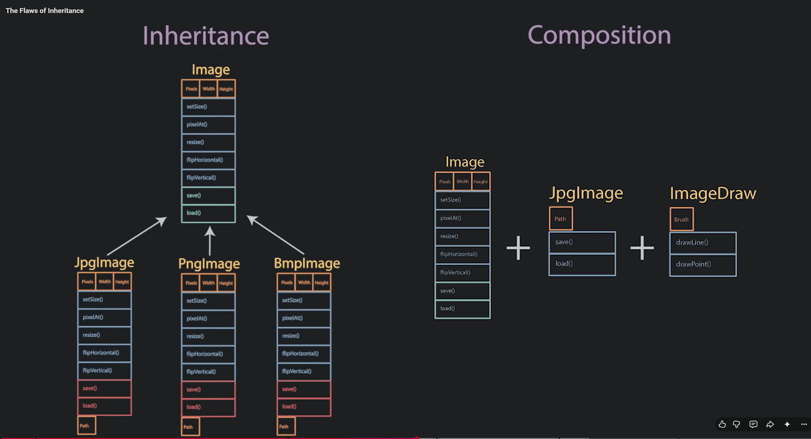

Due Oct 18 11:59pm

20 points possible

# Discussion Topic: Week 9 - Inheritance, Composition, and Polymorphic Design


> When should you reject an AI recommendation to use inheritance and prefer composition?

**Requirements:** Post a substantive response of approximately 200-300 words by Thursday and reply constructively to at least two classmates by Sunday. When code is relevant, use a small code example and explain it in your own words. Cite/link any external source used.

**AI transparency:** If you use an AI assistant to brainstorm, disclose how you used it and identify at least one point you independently verified.

Reply


---

# MY ANSWER (DRAFT):


# AI-ASSISTED DRAFT:

## 💬 Discussion Response

I would reject an AI recommendation to use inheritance when it is mainly trying to reuse code rather than represent a genuine “is-a” relationship. In C++, public inheritance should mean that the derived class can stand in for the base class without breaking the behavior that other code expects. If the relationship is actually “has-a” or “uses-a,” **composition** is usually a better fit: the class contains another object and delegates work to it.

I would look for these warning signs in the AI’s recommendation:

- The derived class would inherit operations that do not make sense for it or would need to disable them.
- The proposed hierarchy adds unnecessary complexity just to share a few methods.
- Features need to vary independently, making a growing collection of subclasses difficult to maintain.
- The design creates unnecessary dependence on the base class’s implementation. Composition can keep that interaction limited to a component’s interface.

## 💻 C++ Example

For example, a `Car` has an `Engine`; it is not a type of `Engine`. Inheriting from `Engine` simply to reuse its `start()` method would model the wrong relationship. A member object expresses the design more accurately: 
```cpp
class Engine {
public:
    void start() {
        // Start the engine.
    }
};

class Car {
private:
    Engine engine;

public:
    void start() {
        engine.start();
    }
};
```

Here, `Car` exposes the operation it needs while keeping the engine as an internal component.

## ✅ How I Would Evaluate the AI’s Advice

My main question would be: “Does this object genuinely need to behave as a specialized version of the proposed base class, or does it just need some of that class’s functionality?” Inheritance can be appropriate for a true, substitutable subtype. If the goal is simply to reuse functionality, I would prefer composition rather than accept the AI’s recommendation just because the generated code compiles.

🤖 AI transparency: I used **Perplexity** to draft my answer, then independently verified the concepts by reviewing several websites and videos discussing when to prefer composition over inheritance. The `Car` and `Engine` example matched one I saw in a video and helped me understand why a “has-a” relationship is better represented through composition.

### References:

- https://www.thoughtworks.com/en-us/insights/blog/composition-vs-inheritance-how-choose
- https://www.youtube.com/watch?v=6MYaUdSuW24
- Web Dev Simplified | Composition Vs Inheritance - Why You Should Stop Using Inheritance: https://www.youtube.com/watch?v=nnwD5Lwwqdo
- CodeAesthetic | The Flaws of Inheritance: https://www.youtube.com/watch?v=hxGOiiR9ZKg
- Metaphorically Speaking | Composition over Inheritance Explained using Retro Games!: https://www.youtube.com/watch?v=HNzP1aLAffM
- [stackoverflow](https://stackoverflow.com/questions/2126633/private-inheritance-and-composition-which-one-is-best-and-why)


### #NOTES:
- The downside of inheritance is you couple tightly to the parent class; the structure of the parent is thrust upon the child
- Expensive refactor
- Change is the enemy of perfect design
- With inheritance, exceptions to the commonality requires big changes
- Alternative is to use COMPOSITION: Reuising code without inheritance



- Inheritance compbines: Reuse and Extending; building an Abastraction
- Define a contract that both sides agree to
- Composition creates a HAS-A relationship: Inheritance creates an IS-A relationship
- **single inheritance:** class can only inherit from a single parent at a time

MANTRA
> Favor composition over inheritance

- Composition follows the **single-responsibility** principle. They are more flexible because they are designed to do ONE THING, and one thing well.
- Inheritance is one of the strongest types of coupling
- **Fragile base class problem:**
- Inheritance is changed into composition with dependency injection
- Not all inheritance is bad and we shouldn't blindly avoid it
- **heuristics for when and when not to use inheritance**