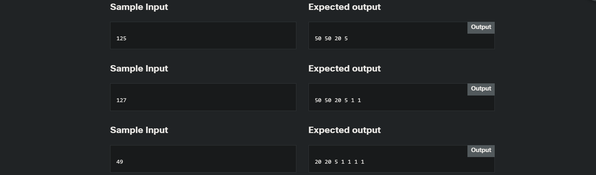

<!-- Custom stylesheet -->
<link rel="stylesheet" href="../../_css/main.css">

<!-- Site logo -->


> [🏚️ README](../../../README.md) | [📁 Courses](../../index.md) | [📚 Vocabulary](../../Vocabulary.md) | [🗓️ Assignments Schedule](../Assignments_Schedule.md) | [🔖 Bookmark](#bookmark)


> CIS 251 - C++ Programming | (Fall 2026 · *Dr. Rosalyn Warren*)   
> 📝 Eric Hepperle's Notes on **Cisco Netacad C++ Essentials 1** course  
> 🧠 CPPE1: Welcome to C++ Essentials 1  

# 🧪 2.8.5   LAB   Collecting banknotes

> https://www.netacad.com/launch?id=4e9bfae1-812a-47b1-9052-43a5f27db6ff&tab=learning&assignment=bdc89584-8c90-42d2-b617-23da0dbf5f55&activeTab=assignmentdetails

---

## Level of difficulty

Hard

## Objectives

Familiarize the student with:

*   using vectors in interactive problems;
*   and improve the student's skills in combining different kinds of loops.

## Scenario

Once upon a time there was a country called Plusplusland. The monetary system they used there was simple: the currency name was the "plussar" and their central bank issued five different banknotes of values 50, 20, 10, 5 and 1 plussar.

Your task is to write a driver for the ATMs of Plusplusland. The driver should find the minimal number of banknotes needed to deliver any amount of money to the client.

The Treasury Minister has asked you personally to do this. He expects your code to print the values of all the needed banknotes in a row – this is the format accepted by all ATMs in Plusplusland.

Test your code using the data we've provided.


---

### Starting Code:

- NONE

---

### Sample Input



---

### Eric's Answer


```cpp
/* ************************************************************
    1.3.20 LAB Ints: operators and expressions
    Student: Eric Hepperle
    Created: 2026-08-29

    GitHub: https://github.com/codewizard13
    email: codewizard13@gmail.com
 ************************************************************ */
```


### Lessons Learned
- ...