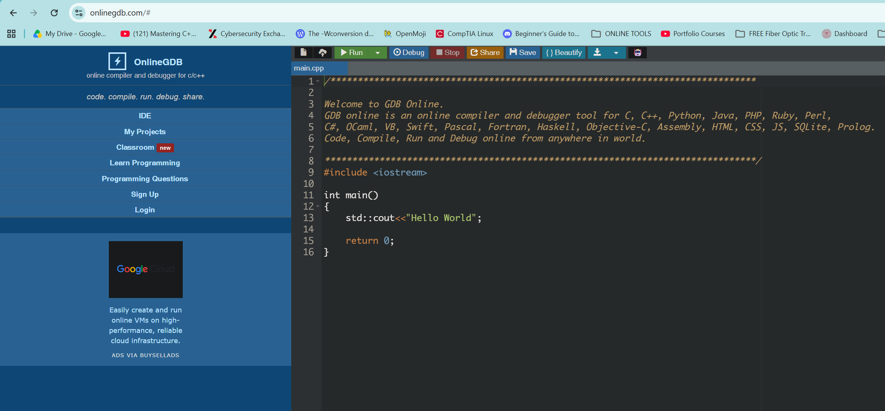

<!-- Custom stylesheet -->
<link rel="stylesheet" href="../../_css/main.css">

<!-- Site logo -->


> [🏚️ README](../../../README.md) | [📁 Courses](../../index.md) | [📚 Vocabulary](../../Vocabulary.md) | [🗓️ Assignments Schedule](../Assignments_Schedule.md) | [🔖 Bookmark](#bookmark)


> ### CIS 251 - C++ Programming:
> Fall 2026 · Dr. Rosalyn Warren


# Week 11 Reading Tutorial & AI Tutor

CIS 251: C++ Programming · Fall 2026 · Dr. Rosalyn Warren

# Week 11: Exceptions, Error Handling, and Robust Programs

**Purpose:** This page is your primary weekly tutorial. The external resources are supplemental. If you cannot reach every external site, study this page carefully, type and run the examples, complete the practice tasks, and use the AI Tutor for explanations.

## Learning Objectives

*   Distinguish normal decisions from exceptional errors.
*   Use try, throw, and catch.
*   Write basic exception-safe input/calculation code.
*   Avoid empty catch blocks.
*   Test error paths intentionally.

**How to study this page:** Read one section at a time. Before running each code example, predict what it will do. Then type it yourself rather than copying it. Modify at least one value or condition and observe the effect.

## 1. Errors vs Exceptions

A normal decision such as “age must be at least 18” is usually handled with `if`. An exception is appropriate for a condition that prevents an operation from completing normally and should be reported to a different level of the program.

## 2. try, throw, catch

```cpp
double divide(double a, double b) {
    if (b == 0) {
        throw runtime_error("Cannot divide by zero.");
    }
    return a / b;
}

try {
    cout << divide(10, 0);
}
catch (const runtime_error& e) {
    cout << "Error: " << e.what() << endl;
}
```

`throw` signals the problem. `catch` handles a matching exception. The error message from a standard exception is available through `what()`.

## 3. Do Not Hide Errors

A catch block should do something meaningful: inform the user, recover safely, log the problem, or allow a higher layer to handle it. An empty catch block makes debugging much harder.

## 4. Testing Error Paths

For robust software, test both successful and failing cases. For division, test positive numbers, negative numbers, decimals, and zero as the divisor. A feature is not fully tested if only the happy path is checked.

## Guided Practice Before Graded Work

1.  Write a divide function that throws on division by zero.
2.  Catch the exception in main().
3.  Change the exception message and verify what() displays it.
4.  List normal-validation cases that should stay as if statements.
5.  Create a small test table containing successful and failing inputs.

## Optional/Supplemental External Readings

The tutorial above contains the required conceptual explanation. Use these resources for another explanation and additional examples:

*   [W3Schools — C++ Exceptions](https://www.w3schools.com/cpp/cpp_exceptions.asp)
*   [TutorialsPoint — C++ Exceptions Handling](https://www.tutorialspoint.com/cplusplus/cpp_exceptions_handling.htm)

## Instructional Videos

For the embedded Bro Code playlist, focus on the following lesson topics this week:

*   exceptions / try-catch
*   error handling and debugging

### Bro Code — C++ Tutorial Playlist

Use this playlist as a second explanation of the week's concepts. Watch the lessons named in the checklist below; pause frequently and type the examples yourself.

> - **#GOTCHA:** Bro code doesn't have any exceptions videos for C++, only for other languages. The concept of exception handling is simple enough, but the actual implemention is critical for each language, so I found some other YouTubers with videos addressing this:
>
> - **Kenny Yip Coding:** Exception Handling C++ https://www.youtube.com/watch?v=MHUNtxnpPgU
> - **NeuralNine:** Exception Handling - C++ Tutorial For Beginners #18 https://www.youtube.com/watch?v=5MI2N8yLdMI

## Preparing for This Week's Programming Assignment

Week 11 should add structured error handling to familiar program logic. You should not be asked to learn an entirely new application domain and exceptions simultaneously.

**Readiness rule:** You should be able to complete the guided-practice tasks without copying a finished solution before beginning the graded programming assignment.

## Self-Check

Answer these in your own words before moving to graded work. If you cannot answer one, return to the relevant section or ask the AI Tutor for an explanation.

1.  What does throw do?
2.  What does catch do?
3.  Why is catch(...) not always the best first choice?
4.  Why should failure cases be part of a test plan?

## CIS 251 AI Tutor

**Use the tutor to learn, not to replace your work.** Ask it to explain a concept, trace a small example, help interpret a compiler error, or quiz you. Do not ask it to complete the graded assignment for you.

**Useful prompts:** “Explain this concept in simpler terms.” “Give me a new practice problem like the example.” “Trace this code line by line.” “Explain this compiler error without writing my assignment.”

**Note:** The AI Tutor interface appears to be up again and I noticed it had the online C++ code runner **[OnlineGDB](https://www.onlinegdb.com)** integrated into it. Here's a screenshot of the website interface:

