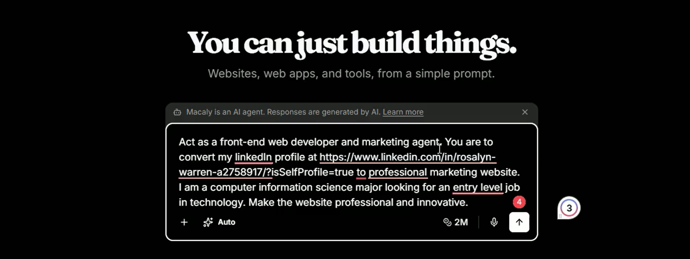
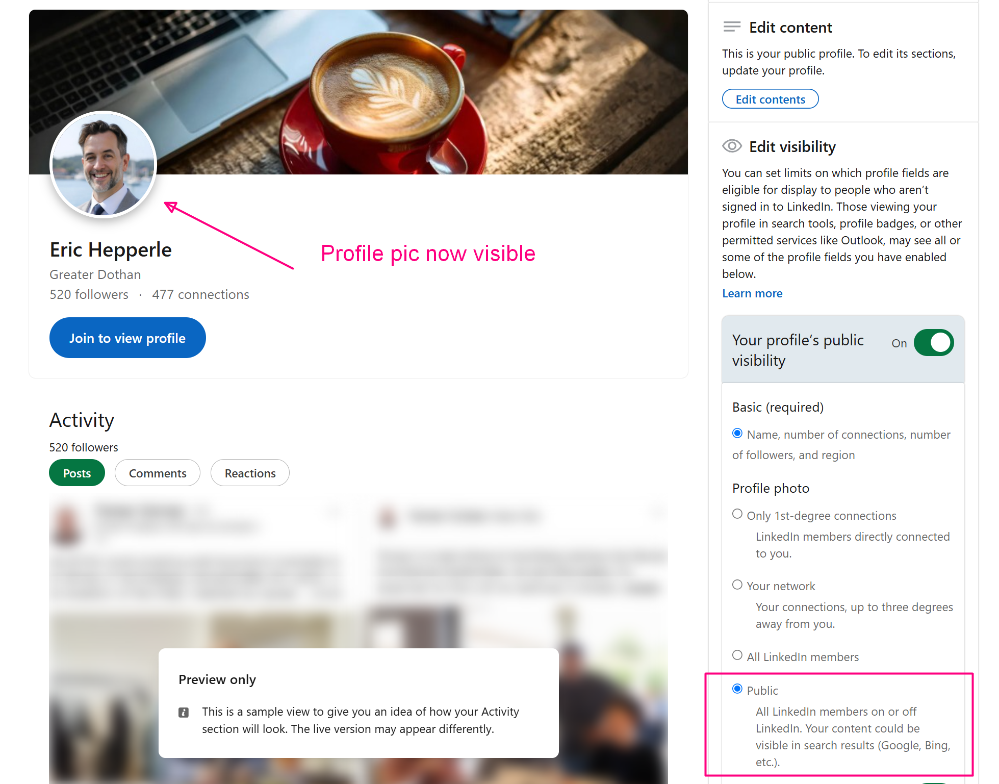

<!-- Custom stylesheet -->
<link rel="stylesheet" href="../../_css/main.css">

<!-- Site logo -->


> [🏚️ README](../../../README.md) | [📁 Courses](../../index.md) | [📚 Vocabulary](../../Vocabulary.md) | [🗓️ Assignments Schedule](../Assignments_Schedule.md) | [🔖 Bookmark](#bookmark)


> CIS 251 - C++ Programming | (Fall 2026 · *Dr. Rosalyn Warren*)   
> 📝 Eric Hepperle's Notes on — **Cisco Netacad C++ Essentials 2** course   
>
> 🧠 Module Introduction: Transform Your LinkedIn Profile with AI  
> **#NOTE**: *This is wedged between Wk 13 & 14* and is a career readiness module

# 🧩 Introduction and Overview

These are Eric Hepperle's notes and student log recording me following this assignment. I've taken pains to provide screenshots to document various stages.

# 🧩 Preparation

- I read the module intro
- downloaded the ebook and skimmed it
- viewed the attached instructor video

## 🟣 Viewing the Video

The instructor provided this prompt for generating a website with Macaly AI based on her LinkedIn profile:




#PROMPT:

Here's her initial prompt text:


```md
Act as a front-end web developer and marketing agent. You are to convert my linkedin profile at https://www.linkedin.com/in/rosalyn-warren-a2758917/?isSelfProfile=true to professional marketing website. I am a computer information science major looking for an entry level job in technology. Make the website professional and innovative.
```

> - **📌 #TIP:** Although there is no `ai` or `prompt` markdown codefence flavor, using `markdown` or `md` is better than plain blocks because they highlight structure like heading levels and therefore are more human-readable.

Then she said if you you don't have any graphics, you can append something like,

```md
Add images from pixabay or pexels.com as needed to make it stand out without being overwhelming.
```

Then she said you'll start off with 3 Million credits every month for free, but there was an error when she ran the prompt. It offered to "retry loading" LinkedIn profile data at a steep cost of 500K credits.

> - ⚠️ #GOTCHA: Running a prompt that scans your LinkedIn profile cost 500K credits!

### 🟠 How to submit

- [ ] The instructor wants you to publish it in Macaly

- [ ] Submit assignment by inviting her or just taking a screenshot.

## 🟣 Reviewing & Documenting My Current LinkedIn Profile

Here's a screenshot of my current LinkedIn profile, as seen from a dummy profile I use for testing & research:

")

> - ⚠️ #GOTCHA: Nobody can see my profile image! 

### 🟠 How to View LinkedIn Profile as Public

I found this [demandbird article](https://demandbird.com/resources/linkedin-profile-as-others-see-it/) on how to view your LinkedIn profile as the public

```md
## How to View Your LinkedIn Profile As Others See It

1.  Log in to LinkedIn
2.  Click **"Me"** in the top-right navigation bar
3.  Choose **"Settings & Privacy"** from the dropdown
4.  Select the **"Visibility"** tab in the left sidebar
5.  Click **"Edit your public profile"**
6.  A preview page opens showing exactly what the public sees on your profile

Shortcut: go directly to [linkedin.com/public-profile/settings](https://www.linkedin.com/public-profile/settings).
```

This is what my profile looks like when I follow those instructions on my own profile (not the dummy one). Noice there are settings toggles in the right sidebar. Those will be important in a moment.


By changing my "Profile Photo" setting to "Public", it is now viewable to everyone (it auto saves),



### 🟠 Changing My Profile Pic with Copilot

Rather than risk eating my some of my Macaly credits I used Microsoft Copilot to generate a new profile pic for my. I told it to reference my current LinkedIn profile pic with my in a gray suit on a yacht. Here's the exact prompt I used:

#PROMPT:

```md
Act as a career coach and marketing agent. You are to create a realistic photo for my LinkedIn profile of me that says without being obnoxious that I work with computers, and preferrably, that I write code. The image should be 512 x 512 pixels and should be based on the attached image. I'm an experienced WordPress web application developer who has recently upskilled by learning C++ and Python fundamentals. I'm copacetic with AI tools, not beginner, not expert.  Don't ask any questions and don't waste my tokens.
```

Here's the result Copilot provided — I love it!


> - **📖 #VOCAB:** *contextual clues* 

If you want to get inspiration for how you can use Macaly, click **Browse Community** button for examples.


---


---

