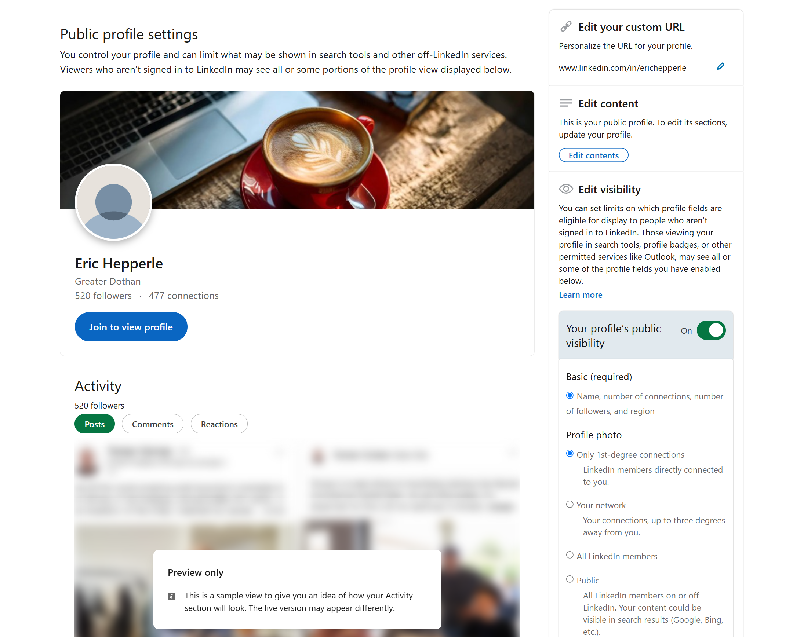
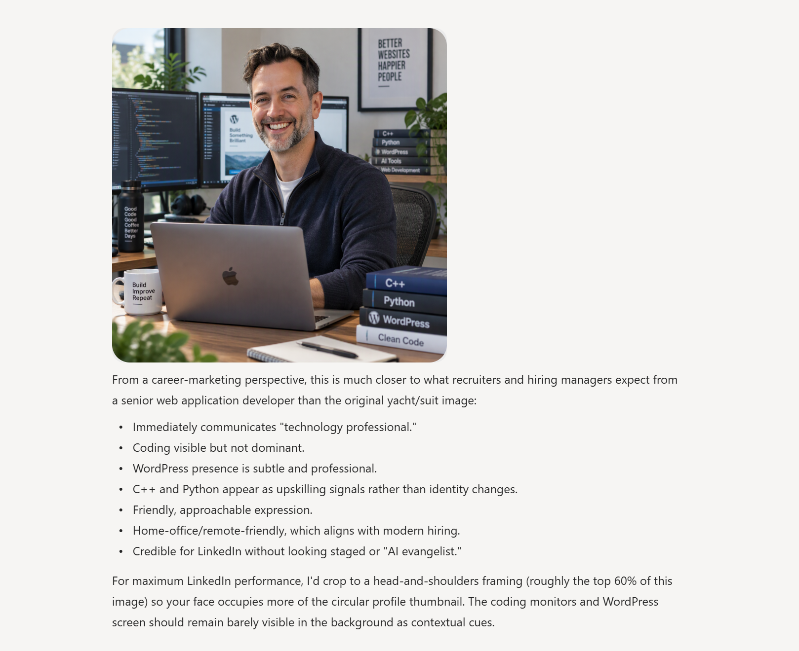

<!-- Custom stylesheet -->
<link rel="stylesheet" href="../../_css/main.css">

<!-- Site logo -->


> [🏚️ README](../../../README.md) | [📁 Courses](../../index.md) | [📚 Vocabulary](../../Vocabulary.md) | [🗓️ Assignments Schedule](../Assignments_Schedule.md) | [🔖 Bookmark](#bookmark)


> CIS 251 - C++ Programming | (Fall 2026 · *Dr. Rosalyn Warren*)   
> 📝 Eric Hepperle's Notes on — **Cisco Netacad C++ Essentials 2** course   
>
> 🧠 Module Introduction: Transform Your LinkedIn Profile with AI  
> **#NOTE**: *This is wedged between Wk 13 & 14* and is a career readiness module

# 🧩 Introduction and Overview

These are Eric Hepperle's notes and student log recording me following this assignment. I've taken pains to provide screenshots to document various stages.

# 🧩 Preparation

- I read the module intro
- downloaded the ebook and skimmed it
- viewed the attached instructor video

## 🟣 Viewing the Video

The instructor provided this prompt for generating a website with Macaly AI based on her LinkedIn profile:


#PROMPT:

Here's her initial prompt text:


```md
Act as a front-end web developer and marketing agent. You are to convert my linkedin profile at https://www.linkedin.com/in/rosalyn-warren-a2758917/?isSelfProfile=true to professional marketing website. I am a computer information science major looking for an entry level job in technology. Make the website professional and innovative.
```

> - **📌 #TIP:** Although there is no `ai` or `prompt` markdown codefence flavor, using `markdown` or `md` is better than plain blocks because they highlight structure like heading levels and therefore are more human-readable.

Then she said if you you don't have any graphics, you can append something like,

```md
Add images from pixabay or pexels.com as needed to make it stand out without being overwhelming.
```

Then she said you'll start off with 3 Million credits every month for free, but there was an error when she ran the prompt. It offered to "retry loading" LinkedIn profile data at a steep cost of 500K credits.

> - ⚠️ #GOTCHA: Running a prompt that scans your LinkedIn profile cost 500K credits!

### 🟠 How to submit

- [ ] The instructor wants you to publish it in Macaly

- [ ] Submit assignment by inviting her or just taking a screenshot.

## 🟣 Reviewing & Documenting My Current LinkedIn Profile

Here's a screenshot of my current LinkedIn profile, as seen from a dummy profile I use for testing & research:

")

> - ⚠️ #GOTCHA: Nobody can see my profile image! 

### 🟠 How to View LinkedIn Profile as Public

I found this [demandbird article](https://demandbird.com/resources/linkedin-profile-as-others-see-it/) on how to view your LinkedIn profile as the public

```md
## How to View Your LinkedIn Profile As Others See It

1.  Log in to LinkedIn
2.  Click **"Me"** in the top-right navigation bar
3.  Choose **"Settings & Privacy"** from the dropdown
4.  Select the **"Visibility"** tab in the left sidebar
5.  Click **"Edit your public profile"**
6.  A preview page opens showing exactly what the public sees on your profile

Shortcut: go directly to [linkedin.com/public-profile/settings](https://www.linkedin.com/public-profile/settings).
```

This is what my profile looks like when I follow those instructions on my own profile (not the dummy one). Noice there are settings toggles in the right sidebar. Those will be important in a moment.



By changing my "Profile Photo" setting to "Public", it is now viewable to everyone (it auto saves),


I subsequently toggle some other settings and here is what I finally came up with.

#### Final Enabled LinkedIn Profile Visibility Settings:

**Basic (required)**

- [x] Name, number of connections, number of followers, and region

**Profile Photo**

- [x] Public: All LinkedIn members on or off LinkedIn. Your content could be visible in search results (Google, Bing, etc.).

**Other Toggles**

- [x] Background photo
- [x] Headline
- [x] Summary
- [x] Articles & Activity (not sure if I want to leave this on or not)
- [x] Certifications
- [x] Projects
- [x] Honors and Awards
- [x] Organizations
- [x] Recommendations

- [x] **Public visibility limits**: Even when your profile’s public visibility is on, we may not display all profile fields. Turning this off may make it easier for unauthorized third parties to collect your public profile data.

After updating those settings, the dummy profile shows this:

")


For good measure, logged into Chrome in **incognito mode** — simulates a not logged-in user — shows this:

")

> - **⚠️ #GOTCHA:** headline is missing, my about is truncated, top skills don't show and activity is floated into the above-fold area.

### 🟠 Changing My Profile Pic with Copilot

Rather than risk eating my some of my Macaly credits I used Microsoft Copilot to generate a new profile pic for my. I told it to reference my current LinkedIn profile pic with my in a gray suit on a yacht. Here's the exact prompt I used:

#PROMPT:

```md
Act as a career coach and marketing agent. You are to create a realistic photo for my LinkedIn profile of me that says without being obnoxious that I work with computers, and preferrably, that I write code. The image should be 512 x 512 pixels and should be based on the attached image. I'm an experienced WordPress web application developer who has recently upskilled by learning C++ and Python fundamentals. I'm copacetic with AI tools, not beginner, not expert.  Don't ask any questions and don't waste my tokens.
```

Here's the result Copilot provided — I love it!




> - **📖 #VOCAB:** *contextual clues* 

If you want to get inspiration for how you can use Macaly, click **Browse Community** button for examples.


---

# 🧩 Prompt Mastery ebook


> - **📌 #TIP:** you must write precise prompts to get useful AI outputs

> - **📖 #VOCAB:** *issuing specifications*


## 🟣 Essential Vocabulary

- **Prompt**: The input (text, code, or image) you feed the AI to generate a response.

- **Context Window**: The amount of information the AI can "remember" in the current conversation. If a conversation gets too long, it forgets the beginning.
  
- **Hallucination**: When the AI confidently generates false information or code libraries that do not exist. *Always verify syntax and facts.*

- **Zero-Shot Prompting**: Asking the AI to do something without giving examples (e.g., "Explain recursion").

- **Few-Shot Prompting**: Giving the AI examples of what you want before asking it to do it (e.g., giving 3 examples of SQL queries before asking for the 4th).

- **Chain of Thought**: Asking the AI to "think step-by-step" to improve logic, especially in math or debugging.

- **System/Persona**: Assigning a specific role to the AI (e.g., "Act as a Senior Network Administrator").

## 🟣 The "Perfect Prompt" Framework — **RCTF**

1. **R - Role:** Who should the AI be? (Tutor, Senior Dev, Data Analyst, Security Auditor)

2. **C - Context:** What is the background? (Language, proficiency level, specific constraints)

3. **T - Task:** What exactly do you need done? (Generate code, explain a concept, debug)

4. **F - Format:** How do you want the output? (Code block, bullet points, table,
JSON)

## 🟣 Roles AI Can Play & Sample Prompts

A. The "Code Buddy" (Debugging)

```md
#PROMPT: 

I am getting a SyntaxError on line 42 of this
Python script. Below is my code. Act as a coding tutor:
Identify the error, explain why it is happening, and
suggest the fix."
```

B. The "Translator" (Concept Explanation)

```md
#PROMPT: 

I am a first-year CIS student. Explain the concept of 'Object-Oriented
Inheritance' using an analogy of a car factory. Then, show a simple Java code example
demonstrating a Parent class and a Child class.
```

C. The "Documentation Generator" (Refactoring)

```md
#PROMPT: 

Here is a raw SQL query I wrote. Please add
comments explaining what each JOIN is doing, and
reformat the code to standard readability conventions
(indentation)."
```

D. The "Socratic Method" (Study Prep)

```md
#PROMPT: 

I am studying for my CompTIA A+ certification. Please ask me 5 multiple-
choice questions about printer troubleshooting. Do not give me the answers
immediately. Wait for my response, then grade me.
```

E. Advanced Techniques: "Few-Shot" Prompting

> - **📌 #TIP:** If the AI isn't following your style, give it examples first. This is **crucial** for formatting data.

```md
#PROMPT: 

I need to convert raw names into a standard JSON format. Follow this pattern:

Input: John Smith (Admin) Output: {"name": "John Smith", "role": "admin"}

Input: Sarah Jones (User) Output: {"name": "Sarah Jones", "role": "user"}

Input: Mike Ross (Guest) Output: ...
```


## 🟣 The Golden Rules of AI in Academia

1. **Trust but Verify:** AI is a probabilistic engine, not a knowledge database. If it gives you a command line  instruction (especially sudo commands), Google it before you run it.

2. **Privacy First:** Never put personal data (PII), passwords, API keys, or proprietary server IP addresses into a public AI chat.

3. **It Can't Read Your Mind:** If the output is wrong, assume your prompt was ambiguous. Iterate and refine.

4. **Attribution:** If you use AI to generate a significant portion of code for an assignment, comment it: // Code generated with assistance from [AI Model].


Troublshooting: When the AI Gets Stuck

If the AI gives you generic or wrong answers, try adding these "magic phrases" to your
prompt:


- "_Let's take this step-by-step._" (Forces logical sequencing).

 - "_Are there any edge cases this code misses?_" (Improves security/robustness).

- "_Critique your previous answer._" (Forces the AI to review its own work).

- "_Explain this as if I'm 12 years old._" (Simplifies dense jargon).


---

