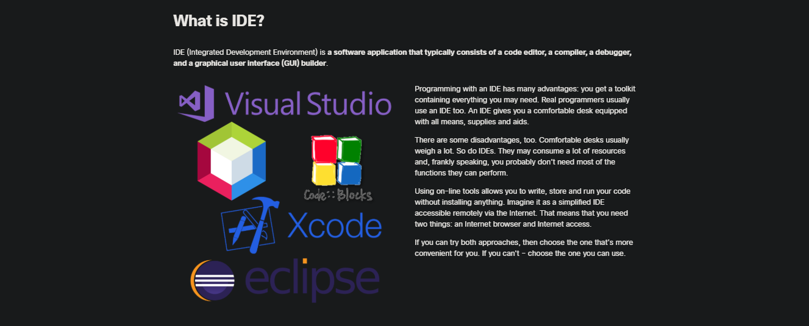
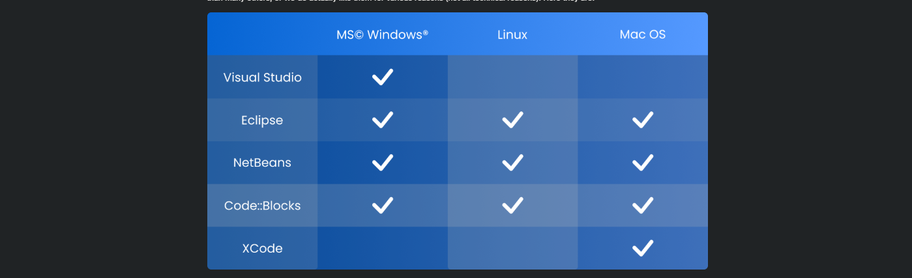
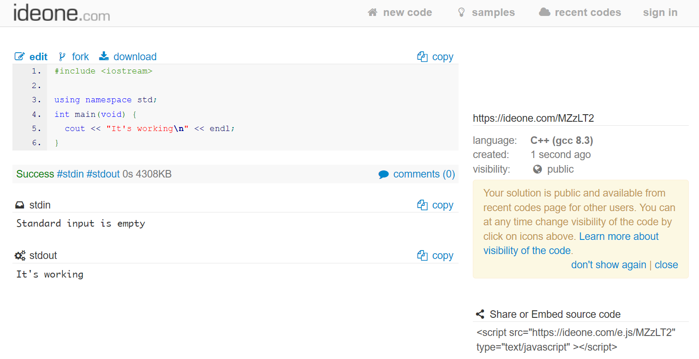
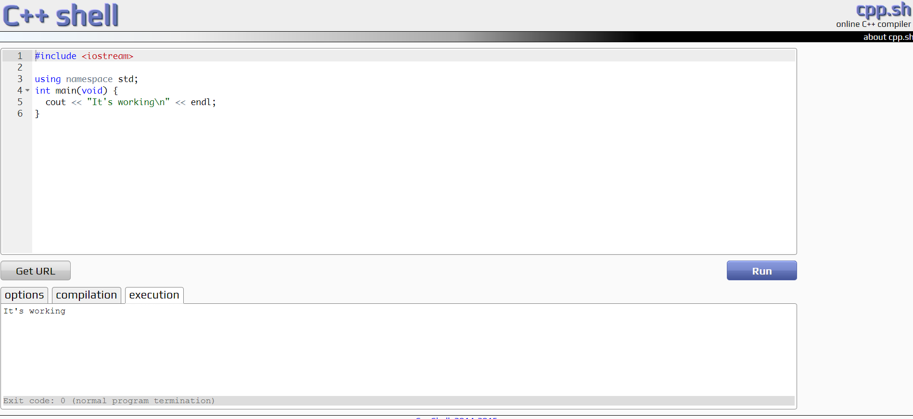
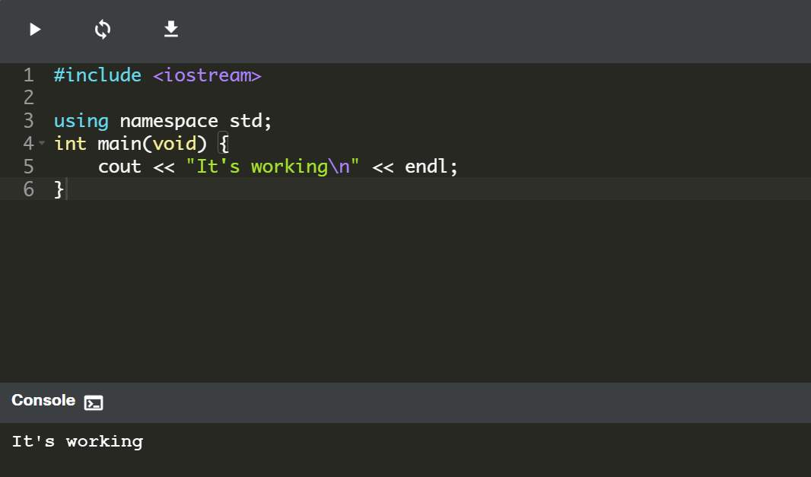

<!-- Custom stylesheet -->
<link rel="stylesheet" href="../../_css/main.css">

<!-- Site logo -->


> [🏚️ README](../../../README.md) | [📁 Courses](../../index.md) | [📚 Vocabulary](../../Vocabulary.md) | [🗓️ Assignments Schedule](../Assignments_Schedule.md) | [🔖 Bookmark](#bookmark)


> CIS 251 - C++ Programming | (Fall 2026 · *Dr. Rosalyn Warren*)   
> 📝 Eric Hepperle's Notes on **Cisco Netacad C++ Essentials 1** course  
> 🧠 CPPE1: Welcome to C++ Essentials 1  

# 🧩 0.1 Getting Started with C++ Programming

## 🟣 0.1.1 Where to begin?

Every creative activity needs tools, and programming is no exception. In its simplest (not to say the most primitive) form, programming requires a sheet of paper and a pencil.

Of course, we’re not going to practice programming like this – it would be quite good practice for writing raw code, but it’s impossible to run and quite impractical. As running the code is the only method of finding out whether it’s correct, programming requires a computer equipped with some additional tools.

In this section, we’ll show you some ways of using your computer as a developer's workstation.

However, don't forget that there are many factors affecting actions that must (or mustn’t) be performed: hardware platform, operating system, operating system version, etc. We don’t know your system, so our guide is general. We’ll show you the direction – you’ll have to find solutions yourself.

All our recommendations need internet access, whether it's just for a short time or throughout. You'll either have to download installation files from the product websites, or use some of the tools that are only available online. Unfortunately, there's no way around this.

Interestingly, you can run all our programs and examples using just a basic text editor and command-line compiler tools, without needing any special software.

However, we advise against this approach. Instead, we suggest using specific applications that bring together a variety of tools in one convenient place.

We generally recommend two approaches:

- Using IDEs installed on your computer, and
- using online tools.

The good news for you is that we've developed Edube Interactive, an online programming environment integrated directly into the course.

This lets you start coding right away without any installations. It's a handy online IDE designed specifically for this course.

But before we dive deeper into Edube Interactive, let's understand what an IDE is and look at some popular ones, in case you're considering installing additional software locally.


---


## 🟣 0.1.2 What is IDE?

IDE (Integrated Development Environment) is **a software application that typically consists of a code editor, a compiler, a debugger, and a graphical user interface (GUI) builder**.



Programming with an IDE has many advantages: you get a toolkit containing everything you may need. Real programmers usually use an IDE too. An IDE gives you a comfortable desk equipped with all means, supplies and aids.

There are some disadvantages, too. Comfortable desks usually weigh a lot. So do IDEs. They may consume a lot of resources and, frankly speaking, you probably don’t need most of the functions they can perform.

Using on-line tools allows you to write, store and run your code without installing anything. Imagine it as a simplified IDE accessible remotely via the Internet. That means that you need two things: an Internet browser and Internet access.

If you can try both approaches, then choose the one that’s more convenient for you. If you can't – choose the one you can use.

## 🟣 0.1.3 Choose your IDE

There are many IDEs on the market, both free and not free. To get a rough idea of how big the list of integrated development environments for the C language is, you can visit this [Wikipedia page](https://en.wikipedia.org/wiki/Comparison_of_integrated_development_environments#C.2FC.2B.2B).

We wrote and tested all our examples with NetBeans and Edube Interactive (EI). It doesn't mean that we think NetBeans and EI are the best. It may be that other products are more in line with your tastes and habits, so you don’t need to follow our path. Feel free to make your own decisions. However, please be aware that very few of the exercises in this course may be **preconfigured for NetBeans and EI**.

For this reason, you need to remember that some practical elements of the course might not work in some other IDEs the way we intended them to work.

We want to show you 5 sample IDEs. Again, this doesn’t mean that we think they’re better than the others – they may be more popular than many others, or we do actually like them for various reasons (not all technical reasons). Here they are:



### 🟠 Microsoft © Visual Studio Express ®

A single-platform development environment designed especially for building C/C++ programs, both under and for the MS Windows operating system.

*   home site: [https://www.visualstudio.com](https://www.visualstudio.com)
*   downloads: [https://visualstudio.microsoft.com/free-developer-offers/](https://visualstudio.microsoft.com/free-developer-offers/)
*   license: proprietary, but limited free version named Visual Studio Community is available for download; registration required.


### 🟠 Eclipse

Multi-platform development environment designed especially for Java. C programming possible without additional configuration (dedicated C/C++ version available for download).

*   home site: [https://eclipse.org](https://eclipse.org)
*   downloads: [https://www.eclipse.org/downloads](https://www.eclipse.org/downloads)
*   license: Eclipse Public License (free and open).


### 🟠 NetBeans

Multi-platform development environment designed especially for Java. C programming possible without additional configuration (dedicated C/C++ version available for download).

*   home site: [https://netbeans.org](https://netbeans.org)
*   downloads: [https://netbeans.apache.org/front/main/download/index.html](https://netbeans.apache.org/front/main/download/index.html)
*   license: Common Development and Distribution License or GNU Public License version 2 (free and open).

### 🟠 Code::Blocks

Multi-platform development environment designed for C/C++ programming. Default Windows installer does not include C compiler - use the one containing “mingw-setup” inside the file name instead.

*   home site: [https://www.codeblocks.org/](https://www.codeblocks.org/)
*   downloads: [https://www.codeblocks.org/downloads/binaries/](https://www.codeblocks.org/downloads/binaries/)
*   license: GNU Public License version 3 (free and open).


### 🟠 XCode

Single-platform development environment designed especially for building applications for operating systems designed by Apple Inc. Programming in C fully available.

*   home site: [https://developer.apple.com/xcode/](https://developer.apple.com/xcode/)
*   downloads: [https://apps.apple.com/us/app/xcode/id497799835?mt=12/](https://apps.apple.com/us/app/xcode/id497799835?mt=12/)
*   license: proprietary but free for Max OS X users; integrated with OS X and preinstalled.


Unfortunately, we can’t provide any support in the installation and/or use of any IDE, either for the ones we mentioned and the ones we didn’t mention. If you run into problems, seek help from vendor of your software or (recommended) from other users of the particular product. There are many available sources: FAQs, forums, help-desks, communities, knowledge bases, etc. It’s unlikely that your problem hasn’t already happened to somebody else, and if it has, it’s very likely that it was solved. Search for solutions and you’ll find them.

If you’re a **Linux user**, try to use your primary system tools to download and install an IDE. If you use any other OS, search for a complete native installation package.


---

## 🟣 0.1.4 Online Tools


To get started with programming, you don't have to install anything. If you're reading this, you (most likely) have a working Internet browser and an active Internet connection. This means that you can use one of the sites below and start programming immediately – just like that.

### 🟠  Ideone

The first one is named **ideone** available at [http://ideone.com](http://ideone.com "http://ideone.com"). Although you don’t need to register to start your work, we suggest that you do – it’ll enable some additional, valuable features.

Signing up is easy – certainly not more difficult than the registration on the S4A website. You can also use your Facebook account to sign into ideone – it’ll make the whole process even faster and more convenient.

After signing in, you’ll have to do some customizing, and two things are essential: change your default programming language to "C++" (don't forget to do that) and then enable syntax highlighting – it’ll make it easier to do your work.

To test the Ideone environment, go to the "new code" tab and just copy-and-paste the text in the editor.

```cpp
#include <iostream>

using namespace std;
int main(void) {
    cout << "It's working\n" << endl;
}
```

Next click the "Ideone it" button. Text saying "It's working" should appear almost immediately in the stdout field – this means that your source code has been happily compiled and run.



Easy? Easy! But... there’s one catch: you’re not allowed to send more than 1000 submissions a month. We don't think that’s really going to affect you, though.

Something important: if your program reads any data from a user, you’ll have to prepare the data inside the stdin field before the code is run (normally the process of reading input is interactive). Check out [http://ideone.com/faq](http://ideone.com/faq "http://ideone.com/faq") for more details.


### 🟠  CPP.SH

Another online tool with similar functionality is **C++ shell**, accessible at [http://cpp.sh/](http://cpp.sh/ "http://cpp.sh/").

Unlike ideone, C++ shell does not require registration and operates on similar principles. However, it lacks some features such as the ability to save or publish your code.



It doesn't include any support, but to tell you the truth, it’s so simple to use that you actually don’t need any help.

Okay, now it's time to start learning some real programming.


### 🟠  Edube Interactive (EI): Your In-Course Tool

As mentioned before, **there's no need for you to install anything**. For all coding practice and experiments, Edube Interactive is at your service, directly within the course.

This interactive online environment is tailored specifically for this course, offering a browser-based sandbox for C++ programming. It lets you run and test code, as well as carry out lab exercises designed to enhance your learning experience.

Click the triangular "Run" button and observe the outcome.



**Starting Code:**

```cpp
#include <iostream>

using namespace std;
int main(void) {
    cout << "It's working\n" << endl;
}
```

In the _Console_ window, you should be able to see the following output:

```sh
It's working
```

which indicates that the code in the editor has been successfully compiled. Congratulations!

We hope you'll appreciate its flexibility and lightweight format as you progress through the course. Ready to dive into some real coding?


---