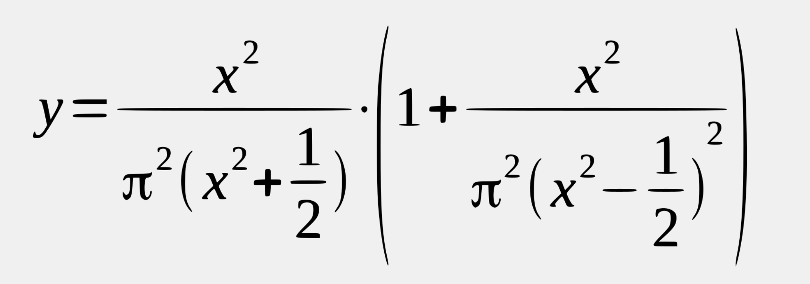

<!-- Custom stylesheet -->
<link rel="stylesheet" href="../../_css/main.css">

<!-- Site logo -->


> [🏚️ README](../../../README.md) | [📁 Courses](../../index.md) | [📚 Vocabulary](../../Vocabulary.md) | [🗓️ Assignments Schedule](../Assignments_Schedule.md) | [🔖 Bookmark](#bookmark)


> CIS 251 - C++ Programming | (Fall 2026 · *Dr. Rosalyn Warren*)   
> 📝 Eric Hepperle's Notes on **Cisco Netacad C++ Essentials 1** course  
> 🧠 CPPE1: Welcome to C++ Essentials 1  

# 🧪 1.3.19   LAB   Floats: operators and expressions

## Objectives

Familiarize the student with:

*   the concept of integers, floating-point numbers, operators and arithmetic operations in C++ programming;
*   understanding the precedence and associativity of C++ operators as well as the proper use of parentheses;
*   performing basic calculations.

## Scenario

Take a look at the code in the editor - it reads a float value, puts it into a variable named _x_ and prints the value of a variable named _y_. Your task is to complete the code in order to evaluate the following expression:



We expect the result to be assigned to _y_.

Note: we've prepared a variable containing the value of π. Use it.

Be careful! Watch the operators and keep their priorities in mind. Remember that classical algebraic notation likes to omit the multiplication operator – you need to use it explicitly.

Don't hesitate to use as many parentheses as you need. Keep your code clean and readable – surround the operators with spaces.

Use additional variables to shorten the expression.

Hint: multiply _x_ by _x_ to get _x_ squared.

Test your code by using the data we've provided – don't be discouraged by any initial failures. Be persistent and inquisitive. Good luck!


**Starting Code:**

```cpp
#include <iostream>

using namespace std;

int main(void) {
	float pi = 3.14159265359;
	float x,y;

	cout << "Enter value for x: ";
	cin >> x;

	// put your code here
	
	cout << "y = " << y;
	return 0;
}
```

> Be persistent and inquisitive.

**Eric's Answer:**

```cpp
/* ************************************************************
    1.3.19 LAB Floats: operators and expressions
    Student: Eric Hepperle
    Created: 2026-08-29

    GitHub: https://github.com/codewizard13
    email: codewizard13@gmail.com
 ************************************************************ */
#include <iostream>
using namespace std;

int main(void) {
	float pi = 3.14159265359;
	float x,y;

	cout << "Enter value for x: ";
	cin >> x;
	
	float x_squared = x*x;
	float pi_squared = pi*pi;

	// put your code here
	float right_den = pi_squared * ((x_squared - (1.0f/2.0f))*(x_squared - (1.0f/2.0f)));
	float right = 1.0f + (x_squared/right_den);
	float left = x_squared / (pi_squared * (x_squared + (1.0f/2.0f)));

	y = left * right;
	
	cout << "y = " << y;

	return 0;
}
```

### #LESSONS_LEARNED 🧠:

> - ⚠️ #GOTCHA: Even though I declared all my variables as `floats`, when I just left the `1/2` as integers, the numbers didn't turn out right. I used Perplexity to help troubleshoot, and learned that you have to pseudo-cast literal ints as floats by adding the `f` prefix onto the end. I had read about that in a previous lesson, but didn't really fully understand the application until I ran into this issue.
>
> - Now I understand that whenever you have an int used in a float calculation, you must write the int as a decimal and append the `f` (ex: `1` should be `1.0f`)
(Ref: https://www.perplexity.ai/computer/tasks/94ca1dd6-4166-48b9-a790-7db3abd63769)

---
