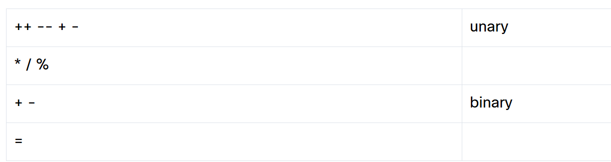

<!-- Custom stylesheet -->
<link rel="stylesheet" href="../../_css/main.css">

<!-- Site logo -->


> [🏚️ README](../../../README.md) | [📁 Courses](../../index.md) | [📚 Vocabulary](../../Vocabulary.md) | [🗓️ Assignments Schedule](../Assignments_Schedule.md) | [🔖 Bookmark](#bookmark)


> CIS 251 - C++ Programming | (Fall 2026 · *Dr. Rosalyn Warren*)   
> 📝 Eric Hepperle's Notes on **Cisco Netacad C++ Essentials 1** course  
> 🧠 CPPE1: Welcome to C++ Essentials 1  

# 🧩 1.3 Operators: Essential Tools for C++ Programming

## 🟣 1.3.15 Increment and decrement operators
  
```cpp
variable++

variable--
```

Return the original (unchanged) variable's value and then increment/decrement the variable by 1.

This behavior justifies the presence of the prefix _pre-_ (before) and _post-_ (after) in the operators’ names: _pre-_ because the variable is modified **first** and then its value is **used**; _post-_ because the variable's value is **used** and then **modified**.


---

## 🟣 1.3.16 Pre-and post-operators and their priorities

#ERIC_WEAK

```cpp
int i, j;

i = 1;
j = i++;
```

First, the variable i is set to 1. In the second statement, we’ll see the following steps:

*   the value of i will be taken (as we use the _post-incrementation_);
*   the variable i will be increased by 1.

In effect, j will receive the value of 1 and i the value of 2.

Things go a bit differently here.

```cpp
int i, j;

i = 1;
j = ++i;
```

  

The variable i is assigned with the value of 1; next, the i variable is incremented and is equal to 2; next, the increased value is assigned to the j variable.

In effect, both i and j will be equal to 2.


Look carefully at this program. Let’s trace its execution step by step.

```cpp
int i, j;

i = 4;
j = 2 * i++;
i = 2 * --j;
```

1.  The i variable is assigned the value of 4;
2.  We take the original value of i (4), multiply it by 2, assign the result (8) to j and eventually (post-)increment the i variable (it equals 5 now);
3.  We (pre-)decrement the value of j (it equals 7 now); this reduced value is taken and multiplied by 2 and the result (14) is assigned to the variable i.

What else do you need to know about the new operators? Firstly, their priority is quite high – higher than the "*", "/" and "%" operators. Secondly, their binding depends on whether you use the prefix or postfix version. The prefix version operators have a right-to-left binding, while the postfix operators bind from left to right.

Our priority table now reads as follows:




---

## 🟣 1.3.17 Shortcut operators


---

