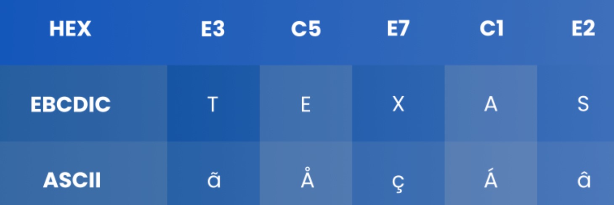
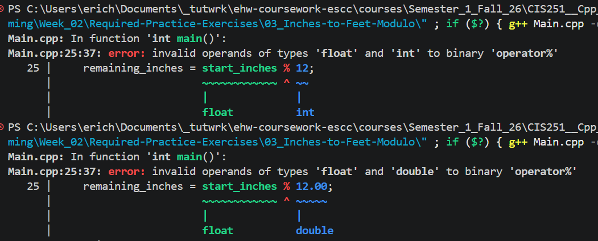
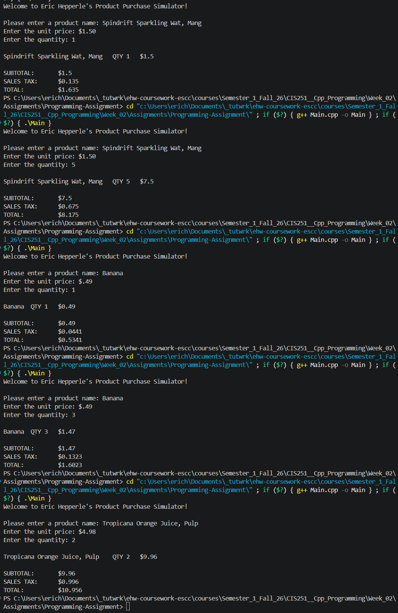

<!-- Custom stylesheet -->
<link rel="stylesheet" href="../../_css/main.css">

<!-- Site logo -->


> [🏚️ README](../../../README.md) | [📁 Courses](../../index.md) | [📚 Vocabulary](../../Vocabulary.md) | [🗓️ Assignments Schedule](../Assignments_Schedule.md) | [🔖 Bookmark](#bookmark)


> CIS 251 - C++ Programming | (Fall 2026 · *Dr. Rosalyn Warren*)   
> 📝 Eric Hepperle's Notes on **Cisco Netacad C++ Essentials 1** course  
> 🧠 CPPE1: Welcome to C++ Essentials 1  

# 🧩 1.4 Characters: Handling Textual Data in C++

> - **word:** string of characters (letters, numbers, punctuation marks, etc.)


> - 📌 #TIP: in the C++ language **all strings are treated as arrays**.

> - **char:** the character (single) data type


---

## 🟣 1.4.2 ASCII code

**Computers store characters as numbers**. Every character used by a computer corresponds to a unique number, and vice versa. This system of assignments includes more characters than you would probably expect. Many of them are invisible to humans but essential for computers. Some of these characters are called **white spaces**, while others are named **control characters**, because their purpose is to **control** the input/output devices. An example of a white space that is completely invisible to the naked eye is a special code, or a pair of codes (different operating systems may treat this issue differently), which are used to mark the ends of lines inside text files. People don’t see this sign (or these signs), but they can see their effect where the lines are broken.

We can create virtually any number of assignments, but a world in which each computer type uses different character encoding would be extremely inconvenient. This has created a need to introduce a universal and widely accepted standard implemented by (almost) all computers and operating systems all over the world. **ASCII** (which is a short for _American Standard Code for Information Interchange_) is the most widely used system in the world, and it’s safe to assume that nearly all modern devices (like computers, printers, mobile phones, tablets, etc.) use this code. The code provides space for 256 different characters, but we’re only interested in the first 128. If you want to see how the code is constructed, go to the table on the right.

  

Look at it carefully – there are some interesting facts about it that you might notice. We'll show you one. Do you see what the code of the most common character is – the space? Yes – it’s 32. Now look at what the code of the lower-case letter “a” is. It’s 97, right? And now let's find the upper-case “A”. Its code is 65. What’s the difference between the code of “a” and “A”? It’s 32. Yes, that's the code of a space. We’ll use that interesting feature of the ASCII code soon.

Also, note that the letters are arranged in **the same order** as in the **Latin alphabet**.

By the way, ASCII code is being superseded (or rather extended) by a new international standard named UNICODE.

Fortunately, the ASCII set is a [UNICODE](https://en.wikipedia.org/wiki/Unicode "UNICODE") subset. UNICODE is able to represent virtually all characters used throughout the world. We’ll spend a little more time on this later.

### ASCII TABLE:  

|     |     |     |     |     |     |     |     |     |     |     |     |     |     |     |     |
| --- | --- | --- | --- | --- | --- | --- | --- | --- | --- | --- | --- | --- | --- | --- | --- |
| Character | Dec | Hex |     | Character | Dec | Hex |     | Character | Dec | Hex |     | Character | Dec | Hex |     |
| (NUL) | 0   | 0   |     | (space) | 32  | 20  |     | @   | 64  | 40  |     | \`  | 96  | 60  |
| (SOH) | 1   | 1   |     | !   | 33  | 21  |     | A   | 65  | 41  |     | a   | 97  | 61  |
| (STX) | 2   | 2   |     | "   | 34  | 22  |     | B   | 66  | 42  |     | b   | 98  | 62  |
| (ETX) | 3   | 3   |     | #   | 35  | 23  |     | C   | 67  | 43  |     | c   | 99  | 63  |
| (EOT) | 4   | 4   |     | ($) | 36  | 24  |     | D   | 68  | 44  |     | d   | 100 | 64  |
| (ENQ) | 5   | 5   |     | %   | 37  | 25  |     | E   | 69  | 45  |     | e   | 101 | 65  |
| (ACK) | 6   | 6   |     | &   | 38  | 26  |     | F   | 70  | 46  |     | f   | 102 | 66  |
| (BEL) | 7   | 7   |     | '   | 39  | 27  |     | G   | 71  | 47  |     | g   | 103 | 67  |
| (BS) | 8   | 8   |     | (   | 40  | 28  |     | H   | 72  | 48  |     | h   | 104 | 68  |
| (HT) | 9   | 9   |     | )   | 41  | 29  |     | I   | 73  | 49  |     | i   | 105 | 69  |
| (LF) | 10  | 0A  |     | \*  | 42  | 2A  |     | J   | 74  | 4A  |     | j   | 106 | 6A  |
| (VT) | 11  | 0B  |     | +   | 43  | 2B  |     | K   | 75  | 4B  |     | k   | 107 | 6B  |
| (FF) | 12  | 0C  |     | ,   | 44  | 2C  |     | L   | 76  | 4C  |     | l   | 108 | 6C  |
| (CR) | 13  | 0D  |     | \-  | 45  | 2D  |     | M   | 77  | 4D  |     | m   | 109 | 6D  |
| (SO) | 14  | 0E  |     | .   | 46  | 2E  |     | N   | 78  | 4E  |     | n   | 110 | 6E  |
| (SI) | 15  | 0F  |     | /   | 47  | 2F  |     | O   | 79  | 4F  |     | o   | 111 | 6F  |
| (DLE) | 16  | 10  |     | 0   | 48  | 30  |     | P   | 80  | 50  |     | p   | 112 | 70  |
| (DC1) | 17  | 11  |     | 1   | 49  | 31  |     | Q   | 81  | 51  |     | q   | 113 | 71  |
| (DC2) | 18  | 12  |     | 2   | 50  | 32  |     | R   | 82  | 52  |     | r   | 114 | 72  |
| (DC3) | 19  | 13  |     | 3   | 51  | 33  |     | S   | 83  | 53  |     | s   | 115 | 73  |
| (DC4) | 20  | 14  |     | 4   | 52  | 34  |     | T   | 84  | 54  |     | t   | 116 | 74  |
| (NAK) | 21  | 15  |     | 5   | 53  | 35  |     | U   | 85  | 55  |     | u   | 117 | 75  |
| (SYN) | 22  | 16  |     | 6   | 54  | 36  |     | V   | 86  | 56  |     | v   | 118 | 76  |
| (ETB) | 23  | 17  |     | 7   | 55  | 37  |     | W   | 87  | 57  |     | w   | 119 | 77  |
| (CAN) | 24  | 18  |     | 8   | 56  | 38  |     | X   | 88  | 58  |     | x   | 120 | 78  |
| (EM) | 25  | 19  |     | 9   | 57  | 39  |     | Y   | 89  | 59  |     | y   | 121 | 79  |
| (SUB) | 26  | 1A  |     | :   | 58  | 3A  |     | Z   | 90  | 5A  |     | z   | 122 | 7A  |
| (ESC) | 27  | 1B  |     | ;   | 59  | 3B  |     | \[  | 91  | 5B  |     | {   | 123 | 7B  |
| (FS) | 28  | 1C  |     | <   | 60  | 3C  |     | \\  | 92  | 5C  |     | \|  | 124 | 7C  |
| (GS) | 29  | 1D  |     | \=  | 61  | 3D  |     | \]  | 93  | 5D  |     | }   | 125 | 7D  |
| (RS) | 30  | 1E  |     | \>  | 62  | 3E  |     | ^   | 94  | 5E  |     | ~   | 126 | 7E  |
| (US) | 31  | 1F  |     | ?   | 63  | 3F  |     | \_  | 95  | 5F  |     |     | 127 | 7F  |


---

## 🟣 1.4.3 Character type values

How do we use the values of the char type in the C++ language? We can do it in two ways, which are not entirely equivalent.

The first way allows us to specify the character itself, but enclosed in single quotes (apostrophes). Let’s assume that we want the variable we declared a few slides earlier to be assigned the value of the upper-case letter “A”.

We do this as follows:

```cpp
character = 'A';
```

You’re not allowed to omit apostrophes under any circumstances.

Now let’s assign an asterisk to our variable. We do this as follows:


```cpp
character = '*';
```

The second method consists of assigning a **non-negative integer value** that is the code of the desired character. This means that the assignment below will put an “`A`” into the character variable.

```cpp
character = 65;
```

  

The second solution, however, is less recommended and if you can avoid it, you should. Why?

The second reason is more exotic, but still true. There’s a significant number of computers in the world which use codes **other than ASCII**. For example, many of the IBM mainframes use a code commonly called [EBCDIC](https://en.wikipedia.org/wiki/EBCDIC "EBCDIC") (_Extended Binary Coded Decimal Interchange Code_) which is very different from ASCII and is based on radically different concepts.




---

## 🟣 1.4.4 ASCII vs EBCDIC


Now imagine that you’ve written a wonderful program and decided to compile and run it on a computer utilizing the EBCDIC code. If you wrote something like this, the compiler running on that computer would notice the question mark and use the appropriate EBCDIC code for that character.

```cpp
character = '?';
```

But if you wrote it like this:

```cpp
character = 63;
```

---

## 🟣 1.4.5 Literal

Now’s probably a good time to bring a new term into the mix: a **literal**. The literal is a symbol which **uniquely identifies its value**. Some prefer to use a different definition: the **literal means itself**. Choose the definition that you consider to be clearer and look at the following simple examples:

*   `character`: this is not a literal; it’s probably a variable name; when you look at it, you cannot guess what value is currently assigned to that variable;
*   `'A'`: this is a literal; when you look at it you can immediately guess its value; you even know that it’s a literal of the `char` type;
*   `100`: this is a literal, too (of the `int` type);
*   `100.0`: this is another literal, this time of a **floating point** type;
*   `i + 100`: this is a combination of a variable and a literal joined together with the `+` operator; this structure is called an **expression**.

If you’re an inquisitive person, you probably want to ask a question: if a literal of type char is given as the character enclosed in apostrophes, how do we code the apostrophe itself?

The C++ language uses a special convention that also extends to other characters, not only to apostrophes. Let's start with an apostrophe anyway. An apostrophe looks like this:

```cpp
character = '\'';
```

The `\` character (called _backslash_) acts as an **escape character**, because by using the `\` we can escape from the normal meaning of the character that follows the slash. In this example, we **escape** from the usual role of the apostrophe (i.e. delimiting the literals of type `char`).

You can also use the escape character to **escape from the escape character**. Yes, it does sound weird, but the example below should make it clear. This is how we put a backslash into a variable of type char.

```cpp
character = '\\';
```


---


> - 📌 #TIP: It appears that you only the NUMERATOR (top number) needs to have a decimal point for the result to be a decimal point (float).


#ERROR_ENCOUNTERED




---

Guided Practice #4-5 PROOF:


> - ⚠️ #GOTCHA: Integer division always ejects / truncates the decimal portion! Use casting on the denominator explicitly write the denominator as a decimal

---


Week 2 Assignment Results:



