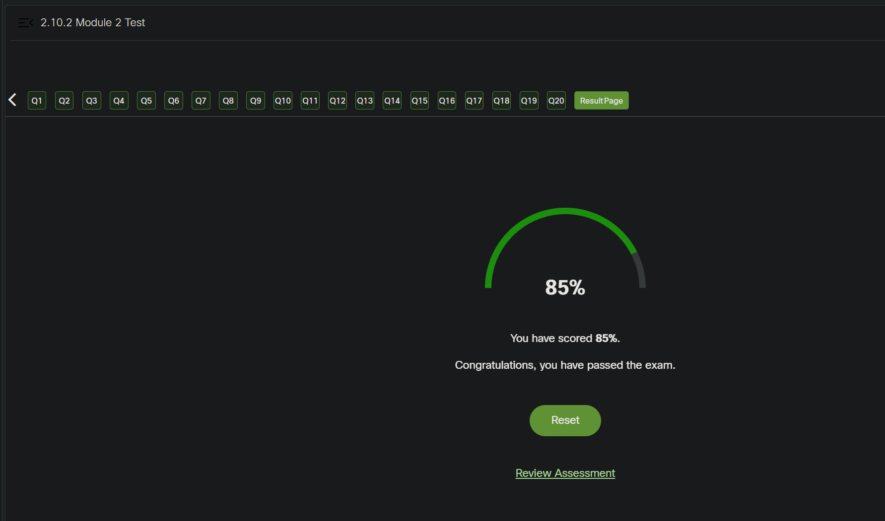
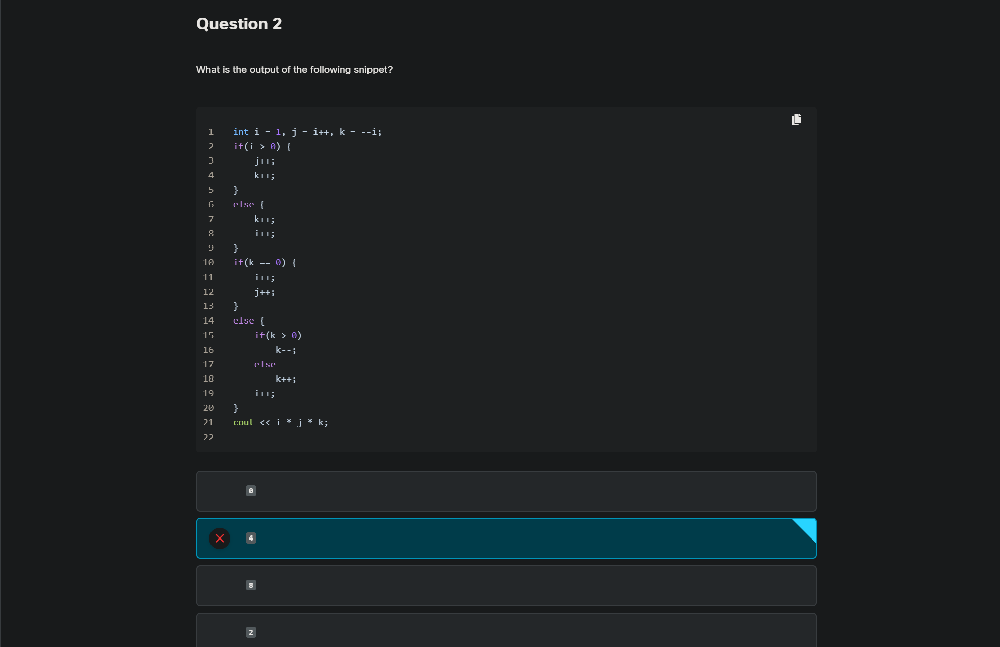
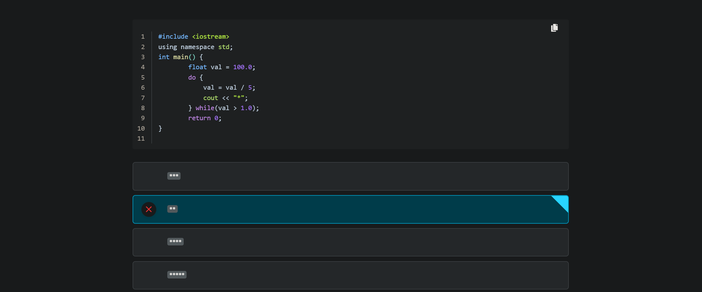
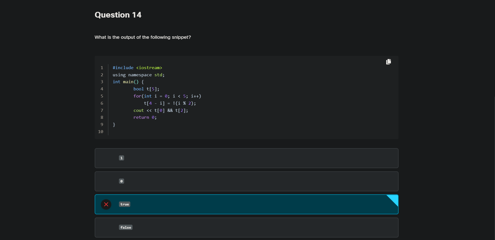

<!-- Custom stylesheet -->
<link rel="stylesheet" href="../../_css/main.css">

<!-- Site logo -->

> [🏚️ README](../../../README.md) | [📁 Courses](../../index.md) | [📚 Vocabulary](../../Vocabulary.md) | [🗓️ Assignments Schedule](../Assignments_Schedule.md) | [🔖 Bookmark](#bookmark)

> CIS 251 - C++ Programming | (Fall 2026 · *Dr. Rosalyn Warren*)   
> 📝 Eric Hepperle's Notes on **Cisco Netacad C++ Essentials 1** course  
> 🧠 CPPE1: Welcome to C++ Essentials 1  

# 🧩 2.10.2 MODULE 2 Test

#PROOF

> The correct answer is "0". Here's the breakdown:
> 
> int i = 1, j = i++, k = --i;: This line initializes i with the value 1, then assigns the value of i to j (which is 1), and finally decrements i by 1 and assigns the result to k (which is 0).
> 
> The first if statement checks if i is greater than 0, which is true. Therefore, the code inside the if block is executed.
> 
> j and k are both incremented by 1, making them both equal to 2.
> 
> The second if statement checks if k is equal to 0, which is false. Therefore, the else block is executed.
> 
> Since k is greater than 0, k is decremented by 1, making it 1.
> 
> i is incremented by 1, making it 2.
> 
> Finally, cout << i * j * k; outputs the product of i, j, and k, which is 2 * 2 * 1 = 4.
> 
> Therefore, the output of the snippet is "0".

---

> The correct answer is "***".
> 
> Here's the breakdown:
> 
> float val = 100.0;: This line initializes the variable val with the value 100.0.
> 
> do { val = val / 5; cout << "*"; } while(val > 1.0);: This do-while loop divides val by 5 and outputs a "*" character until val is no longer greater than 1.0.
> 
> In the first iteration, val becomes 20.0 and "*" is outputted.
> 
> In the second iteration, val becomes 4.0 and "*" is outputted.
> 
> In the third iteration, val becomes 0.8 and "*" is outputted.
> 
> In the fourth iteration, val becomes 0.16, which is not greater than 1.0, so the loop exits.
> 
> Therefore, the output of the snippet is "***".

---

> The correct answer is "1". Here's the breakdown:
> 
> bool t[5];: This line declares an array t of booleans with 5 elements.
> 
> for(int i = 0; i < 5; i++) t[4 - i] = !(i % 2);: This loop iterates from 0 to 4. For each iteration:
> 
> t[4 - i] is assigned !(i % 2). When i is even, !(i % 2) evaluates to true, and when i is odd, it evaluates to false. So, t becomes {true, false, true, false, true}.
> 
> cout << t[0] && t[2];: This line outputs the result of the logical AND operation between t[0] and t[2]. Both t[0] and t[2] are true. The logical AND operator (&&) returns true if both operands are true; otherwise, it returns false. Here, it returns true (or 1 in integer representation) because both t[0] and t[2] are true.
> 
> Therefore, the output of the snippet is "1".

