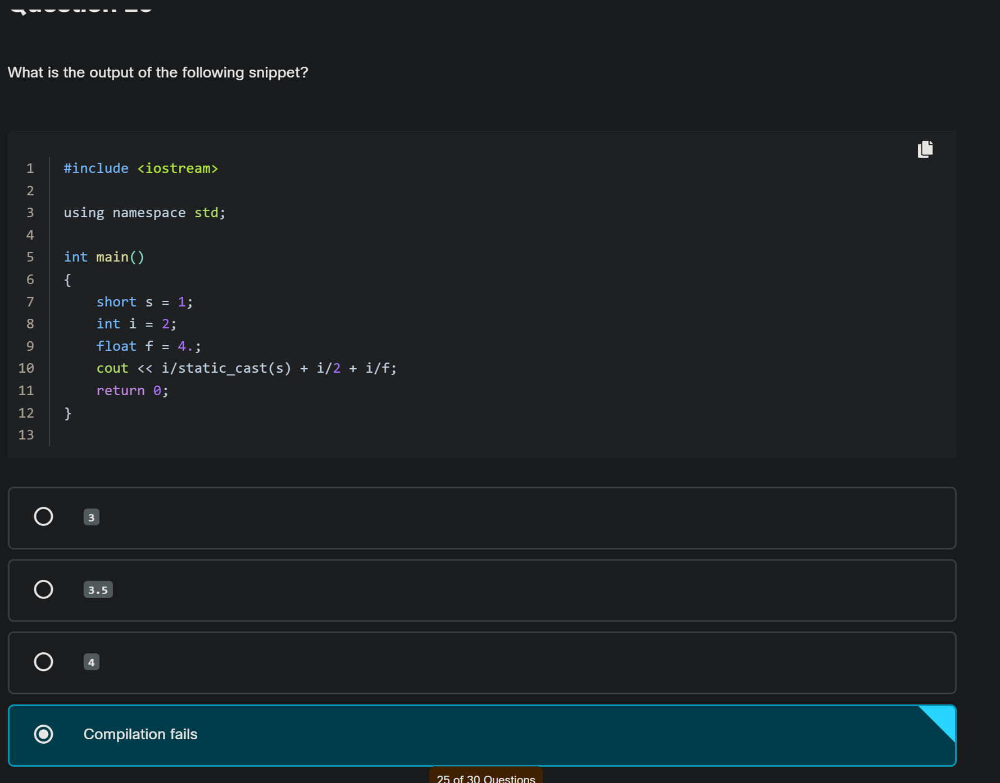
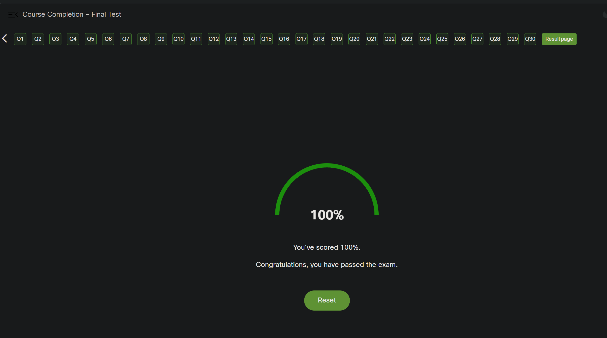
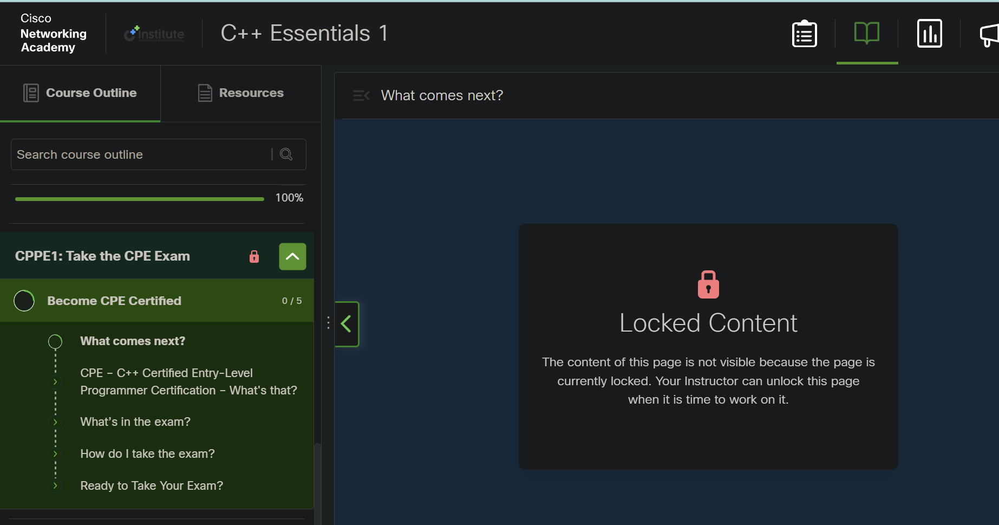

<!-- Custom stylesheet -->
<link rel="stylesheet" href="../../_css/main.css">

<!-- Site logo -->

> [🏚️ README](../../../README.md) | [📁 Courses](../../index.md) | [📚 Vocabulary](../../Vocabulary.md) | [🗓️ Assignments Schedule](../Assignments_Schedule.md) | [🔖 Bookmark](#bookmark)

> CIS 251 - C++ Programming | (Fall 2026 · *Dr. Rosalyn Warren*)   
> 📝 Eric Hepperle's Notes on — **Cisco Netacad C++ Essentials 1** course   
>
> 🧠 Taken: 11/04/2026
> Score: 100%  

# 🎒 CPPE1 FINAL EXAM (End-of-Course Test)

---

---

#PROOF:

---

