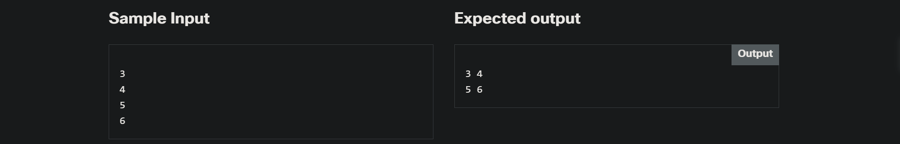

<!-- Custom stylesheet -->
<link rel="stylesheet" href="../../_css/main.css">

<!-- Site logo -->


> [🏚️ README](../../../README.md) | [📁 Courses](../../index.md) | [📚 Vocabulary](../../Vocabulary.md) | [🗓️ Assignments Schedule](../Assignments_Schedule.md) | [🔖 Bookmark](#bookmark)


> CIS 251 - C++ Programming | (Fall 2026 · *Dr. Rosalyn Warren*)   
> 📝 Eric Hepperle's Notes on — **Cisco Netacad C++ Essentials 2** course   
>
> 🧠 CPPE2: Module 4: Operators and Enumerated Types  

# 🧪 4.0.8   LAB   Operators: iostream and operators

## Level of difficulty

Medium

## Objectives

Familiarize the student with:

*   writing operator code;
*   writing iostream operators.

## Scenario

Write a container class that holds the values of simple matrices (with a 2x2 size).

Add operators (i.e. << and \>>) to print this matrix on the screen and get the values of this matrix.

Test this class with different values. Use only a constructor to create a matrix and use operators to get the values from the user and to print the matrices to the user.


---

## Sample Input




## Sample Solution

```cpp
#include <iostream>

using namespace std;
class Matrix2x2
{
public:
	Matrix2x2(double v1, double v2, double v3, double v4)
	{
		v[0][0] = v1;
		v[0][1] = v2;
		v[1][0] = v3;
		v[1][1] = v4;
	}

	void addValue(const double& rhs)
	{
		switch(lastAdded)
		{
		case 0:v[0][0] = rhs;break;
		case 1:v[0][1] = rhs;break;
		case 2:v[1][0] = rhs;break;
		case 3:v[1][1] = rhs;break;
		}
		lastAdded++;
		if (lastAdded > 4)
			lastAdded = 0;
	}

	void operator<<(const double& rhs) 
	{
		addValue(rhs);
	}
	void print(ostream &os) const
	{
		os << v[0][0] << " " << v[0][1] << endl;
		os << v[1][0] << " " << v[1][1] << endl;
	}
private:
	int lastAdded = 0;
	double v[2][2];
};


istream& operator>>(istream& is, Matrix2x2& rhs)
{
	double value;
	is >> value;
	rhs.addValue(value);
	return is;
}


ostream& operator<<(ostream& os, const Matrix2x2& rhs)
{
	rhs.print(os);
	return os;
}

int main(void) {
	Matrix2x2 m(1, 5.5, 6, 9);
	//m << 3;//LEFT intentionally - for clarification
	//m << 4;
	//m << 5;
	//m << 6;
	cin >> m;
	cin >> m;
	cin >> m;
	cin >> m;
	cout << m;
	
	return 0;
}
```

## Eric's Answer


## 🧠 #LESSONS_LEARNED:
