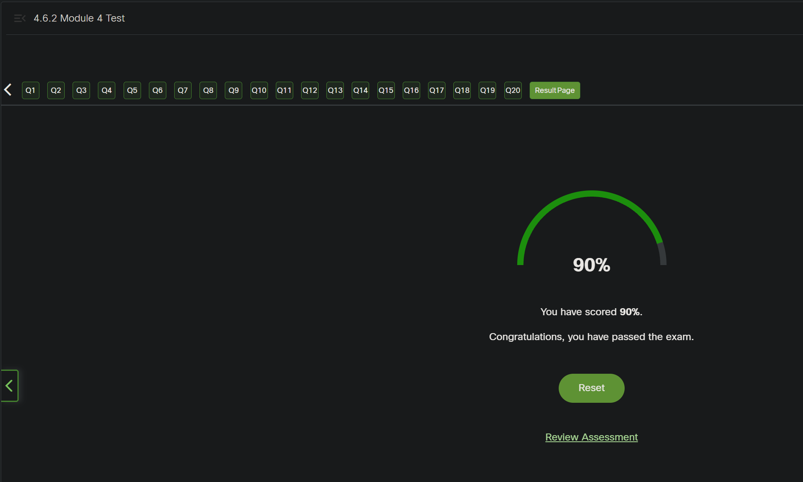

<!-- Custom stylesheet -->
<link rel="stylesheet" href="../../_css/main.css">

<!-- Site logo -->


> [🏚️ README](../../../README.md) | [📁 Courses](../../index.md) | [📚 Vocabulary](../../Vocabulary.md) | [🗓️ Assignments Schedule](../Assignments_Schedule.md) | [🔖 Bookmark](#bookmark)


> CIS 251 - C++ Programming | (Fall 2026 · *Dr. Rosalyn Warren*)   
> 📝 Eric Hepperle's Notes on — **Cisco Netacad C++ Essentials 2** course   
>
> 🧠 CPPE2: Module 4: Operators and Enumerated Types  

# 🎒 2.10.2 MODULE 2 Test

## ❓ Question 1

What is the output of the following program?

```cpp
#include <iostream>
using namespace std;
    
int main() {
    char   t[3][3], *p = (char *)t;
       
    for(int i = 0; i < 9; i++)
        *p++ = 'a' + i;
    cout << t[1][1];
    return 0;
}
```

- e  #MY_GUESS
- q
- c
- compilation fails

> **🧠 Lessons learned**
> 
> - A 2-D array like `char t[3][3]` is stored as nine contiguous `char` values, arranged conceptually in rows and columns.
> - `(char *)t` is a **type cast**: it converts `t`’s row-pointer form into a `char*`, allowing pointer `p` to move one character at a time.
> - `*p++` means “store through `p`, then increment `p`,” so the loop fills the array in row-major order: `a` through `i`.

---

## ❓ Question 2

What is the output of the following program?


```cpp
#include <iostream>
using namespace std;
    
int main() {
    float *ft[3] = { new float[3], new float[3], new float[3] }, *p;
       
    for(int i = 0; i < 3; i++) {
        p = ft[i];
        *p = p[1] = *(p + 2) = 10 * i;
    }
    cout << ft[1][1];
    delete [] ft[0];
    delete [] ft[1];
    delete [] ft[2];
    return 0;
}
```

- 10  #MY_GUESS
- 30
- 20
- compilation fails


> **🧠 Lessons learned**
> 
> The C++ line
> 
> ```
> *p = p[1] = *(p + 2) = 10 * i;
> ```
> 
> assigns the same value to all three elements of an array, working from right to left.
> 
> Let's break it down step by step.
> 
> **1. Understand the array**
> 
> Assume `p` points to the first element of a dynamically allocated array of three `float` values:
> 
> ```
> float* p = new float[3];
> ```
> 
> Think of the array as three boxes in memory.
> 
> Each box holds one float. The pointer p identifies the first element.
> 
> Here is what the expressions mean:
> 
> | Expression | Meaning                                       |
> | ---------- | --------------------------------------------- |
> | `*p`       | The value stored in the first element, `p[0]` |
> | `p[1]`     | The value stored in the second element        |
> | `*(p + 2)` | The value stored in the third element, `p[2]` |
> 
> Key idea: Pointer arithmetic moves by elements, not by individual bytes. So `p + 2` points to the third element.
> 
> **Remember these three things**
> 
> 1. `*p` accesses the first element.
> 2. `p[1]` and `*(p + 2)` access the second and third elements, respectively.
> 3. Chained assignment works right to left, and each assignment expression yields the value assigned, allowing that value to flow into the next assignment.
> 
> The statement is equivalent to writing these three lines:
> 
> ```
> *p       = 10 * i;
> p[1]     = 10 * i;
> p[2]     = 10 * i;
> ```
> 
> Both versions set all three array elements to the same value.


---

## ❓ Question 3

What is the output of the following program?

```cpp
#include <iostream>
using namespace std;
    
int main() {
    int *it[3];
     
    for(int i = 0; i < 3; i++) {
        it[i] = new int [i + 1];
        for(int j = 0; j < i + 1; j++)
            it[i][j] = 10 * i + j;
    }
    cout << it[2][2];
    for(int i = 0; i < 3; i++)
        delete [] it[i];
    return 0;
}
```

- 11
- compilation fails
- 33
- 22 #MY_GUESS


> **📚 Review these topics**
> 
> - **Pointer variables versus pointed-to values:** Distinguish `it [hank.feild](https://hank.feild.org/feild-guide-cpp/pointers.html)` (an address/pointer) from `it [hank.feild](https://hank.feild.org/feild-guide-cpp/pointers.html)` (an integer stored in its allocated array).
> - **Arrays of pointers:** Read declarations such as `int *it [web.eecs.umich](https://web.eecs.umich.edu/~sugih/courses/eecs281/f11/lectures/Discussion2.pdf)` as “three `int*` pointers,” not as a rectangular 2-D `int` array.
> - **Dynamic arrays with `new[]`:** Understand that `new int[n]` allocates `n` consecutive `int` elements and returns a pointer to element 0. [hank.feild](https://hank.feild.org/feild-guide-cpp/pointers.html)
> - **Subscript notation as pointer dereferencing:** Learn that `p[j]` is another notation for `*(p + j)`. [web.eecs.umich](https://web.eecs.umich.edu/~sugih/courses/eecs281/f11/lectures/Discussion2.pdf)
> - **Jagged arrays:** Draw the outer pointer array and each separately allocated row; rows may have different lengths.


---

## ❓ Question 4

What is the output of the following program?


```cpp
#include <iostream>
using namespace std;
    
int main() {
    short s = 1;
    int i = 2;
    long l = 3;
    float f = 4.4;
    double d = 6.6;
        
    cout << s/i + f/i + d/s;
    return 0;
}
```

- compilation fails
- 8.8 #MY_GUESS
- 4.4
- 6.6


> **📝 Casting a `double` to a `long`**
> 
> When you cast a `double` to a `long`, the fractional part is **truncated**—discarded toward zero, not rounded to the nearest integer. The result has type `long`. [learn.microsoft](https://learn.microsoft.com/en-us/cpp/cpp/standard-conversions?view=msvc-170)
> 
> ```cpp
> double a = 7.99;
> double b = -7.99;
> 
> long x = static_cast<long>(a); //  7
> long y = static_cast<long>(b); // -7
> ```
> 
> Both conversions simply drop the fractional part. Notice that `-7.99` becomes `-7`, not `-8`, because truncation moves toward zero. [learn.microsoft](https://learn.microsoft.com/en-us/cpp/cpp/standard-conversions?view=msvc-170)
> 
> **⚠️ Important limitation**
> 
> The resulting whole-number value must fit within the range of `long`. If it does not, the conversion has undefined behavior—you cannot rely on a particular result. [learn.microsoft](https://learn.microsoft.com/en-us/cpp/cpp/standard-conversions?view=msvc-170)
> 
> **🎯 Test-ready answer**
> 
> > The fractional part is discarded, leaving the integer portion, provided that value fits in a `long`. [learn.microsoft](https://learn.microsoft.com/en-us/cpp/cpp/standard-conversions?view=msvc-170)


---

## ❓ Question 5

What is the output of the following program?


```cpp
#include <iostream>
using namespace std;
    
int main() {
    short s = 1;
    int i = 2;
    long l = 3;
    float f = 4.4;
    double d = 6.6;
        
    cout << s/float(i) + int(f)/i + long(d)/s;
    return 0;
}
```

- 8.5 #MY_GUESS
- 8.8
- 8.0
- compilation fails


---

## ❓ Question 6

What is the output of the following program?


```cpp
#include <iostream>
using namespace std;
    
int main() {
    int i = 2;
    float f = 5.8;
        
    f = (int)f;
    i = (float) i;
    cout << f/i;
    return 0;
}
```

- 0
- false
- true
- 2.5 #MY_GUESS


---

## ❓ Question 7

What is the output of the following program?


```cpp
#include <iostream>
using namespace std;
    
int main() {
    int i = 2;
    float f = 4.4;
        
    cout << f % float(i);
    return 0;
}
```

- 2
- compilation fails
- 0.2
- 0 #MY_GUESS


---

## ❓ Question 8

What is the output of the following program?


```cpp
#include <iostream>
#include <string>
using namespace std;
    
int main() {
    int i = 2;
    string s = "2";
        
    cout << s + i;
    return 0;
}
```

- compilation fails #MY_GUESS
- 2
- 2
- 4


> ## ✅ Yes—your exact code fails to compile
> 
> I rechecked: `s + i` is invalid because `s` is a `std::string` and `i` is an `int`. There is no matching `operator+` for those operand types. Your program prints nothing because compilation fails. [stackoverflow](https://stackoverflow.com/questions/15957860/operator-on-string-and-int)
> 
> ```cpp
> int i = 2;
> string s = "2";
> 
> cout << s + i; // Compilation error: no matching operator+
> ```
> 
> ### 🔍 Why an integer does not automatically become a character
> 
> C++ supports `string + char`, but that does not make `string + int` valid. The relevant `operator+` is a function template: the string argument implies character type `char`, while the integer argument implies `int`. Those conflicting deductions cause the overload to fail rather than automatically converting the integer to a character. [stackoverflow](https://stackoverflow.com/questions/15957860/operator-on-string-and-int)
> 
> A potentially confusing distinction is that `s += i` can compile: that operator can convert the integer to a character and append it—not append its decimal digits. But your code uses `+`, not `+=`. [stackoverflow](https://stackoverflow.com/questions/15957860/operator-on-string-and-int)
> 
> For your test, the answer remains: **compilation error**.


---

## ❓ Question 9

What is the output of the following program?


```cpp
#include <iostream>
#include <string>
using namespace std;
    
int main() {
    string s = "1"; // Change the value of s to "1"
        
    cout << s  << "b" << "c";
    return 0;
}
```

- 1bc  #MY_GUESS
- ab
- a
- 1


---

## ❓ Question 10

What is the output of the following program?


```cpp
#include <iostream>
#include <string>
using namespace std;
    
int main() {
    string s = "a";
        
    cout << s + "b" + "c";
    return 0;
}
```

- ab
- abc  #MY_GUESS
- a
- compilation fails


---

## ❓ Question 11

What is the output of the following program?


```cpp
#include <iostream>
#include <string>
using namespace std;
    
int main() {
    string s1 = "ab";
    string s2 = "Abc";
        
    if(s1 > s2)
        cout << "yes";
    else
        cout << "NO";
    return 0;
}
```

- yes  #MY_GUESS
- it prints nothing
- compilation
- NO


> ## ✅ Output
> 
> On typical ASCII-compatible systems, this program prints:
> 
> ```text
> yes
> ```
> 
> `std::string` comparisons are case-sensitive and **lexicographical**: they compare corresponding characters from left to right, stopping at the first difference. [geeksforgeeks](https://www.geeksforgeeks.org/dsa/comparing-two-strings-cpp/)
> 
> ## 🔍 Why `"ab" > "Abc"`
> 
> The very first characters differ:
> 
> | String | First character | ASCII value |
> |---|---|---:|
> | `s1 = "ab"` | `'a'` | 97 |
> | `s2 = "Abc"` | `'A'` | 65 |
> 
> Because `97 > 65`, `"ab"` compares greater than `"Abc"`. The condition is true, so the `if` branch prints `yes`. The remaining characters do not affect the comparison. [reddit](https://www.reddit.com/r/cpp_questions/comments/18xs1ub/question_about_string_comparisons/)
> 
> ## 🧠 Key test takeaway
> 
> String comparison does not simply compare lengths. Length decides the ordering only when all characters in the shorter string match the beginning of the longer string—for example, `"ab" < "abc"`. In your example, `'a'` versus `'A'` decides the result immediately. [cplusplus](https://cplusplus.com/reference/string/string/compare/)


---

## ❓ Question 12

What is the output of the following program?


```cpp
#include <iostream>
using namespace std;
    
int main() {
    string s1 = "Ab";
    string s2 = "Abc";
        
    cout << s1.compare(s1);
    return 0;
}
```

- compilation fails
- -1
- 1
- 0 #MY_GUESS


---

## ❓ Question 13

What is the output of the following program?


```cpp
#include <iostream>
using namespace std;
    
int main() {
    string s1 = "1";
    string s2 = "12";
        
    cout << s1.compare(s2);
    return 0;
}
```

- -1   #MY_GUESS
- 0
- 1
- compilation fails


---

## ❓ Question 14

What is the output of the following program?


```cpp
#include <iostream>
#include <string>
using namespace std;
  
int main() {
    string s = "0123456789";
    cout << s.substr(3,7).substr(2).substr();
    return 0;
}
```

- compilation fails
- it prints an empty string
- 34567
- 56789   #MY_GUESS


---

## ❓ Question 15

What is the output of the following program?


```cpp
#include <iostream>
#include <string>
using namespace std;
    
int main() {
    string s = "ABCDEF";
    for(int i = 1; i < s.length(); i += 2)
        s[i - 1] = s[i] + 'a' - 'A';
    cout << s;
    return 0;
}
```

- bBdDfF   #MY_GUESS
- BBDDFF
- aAcCeE
- Compilation fails


---

## ❓ Question 16

What is the output of the following program?


```cpp
#include <iostream>
#include <string>
using namespace std;
    
int main() {
    string s = "AB";
    s.append(s).push_back(s[s.length() - 1]);
    cout << s;
    return 0;
}
```

- ABABA   #MY_GUESS
- Compilation fails
- ABABB
- ABAB

---

## ❓ Question 17

What is the output of the following program?


```cpp
#include <iostream>
#include <string>
using namespace std;
    
int main() {
    string s1 = "aleph";
    string s2 = "alpha";
    string s;
    s1.swap(s2);
    s2.swap(s);
    s.swap(s2);
    cout << s2;
    return 0;
}
```

- alpha
- aleph
- it prints an empty string
- compilation fails


---

## ❓ Question 18

What is the output of the following program?


```cpp
#include <iostream>
    
using namespace std;
    int A;
}
   
namespace SpaceB {
    int A;
}
   
namespace SpaceB {
    int A;
}
    
using namespace SpaceA, SpaceB;
    
int main() {
    SpaceA::A = SpaceB::A = 1;
    std::cout << A + 1;
    return 0;
}
```

- 2
- 0
- compilation fails   #MY_GUESS
- 1


---

## ❓ Question 19

What is the output of the following program?


```cpp
#include <iostream>
using namespace std;
    
namespace S1 {
int A = 1;
}
    
namespace S2  {
int A = 2 ;
}
    
int main(void) {
    { using namespace S1;
        S2::A = A + 1;
    }
    { using namespace S2;
        S1::A = A + 1;
    }
    cout << S1::A << S2::A;
    return 0;
}
```

- compilation fails
- 33
- 32  #MY_GUESS
- 23


---

## ❓ Question 20

What is the output of the following program?


```cpp
#include <iostream>
using namespace std;
    
namespace S {
int A = 1;
}
    
namespace S {
int B = A + 2 ;
}
    
int main(void) {
    S::A = S::A + 1;
    { using namespace S;
        ++B;
    }
    cout << S::B << S::A;
    return 0;
}
```

- 32
- compilation fails
- 42   #MY_GUESS
- 22


---- -------------------- END TEST ---------------------- ----


#PROOF



## WRONG ANSWERS & CORRECTIONS 

Question 7:

The correct answer is that compilation fails. This is because the modulus operator (%) cannot be used with floating-point operands. In C++, the modulus operator is only defined for integer operands. Therefore, when trying to use the modulus operator with a floating-point operand ('f') and a floating-point operand ('float(i)'), the compiler will raise an error.

2: This is incorrect because '2' is not the correct output. The program doesn't compile, so it doesn't produce any output.

0.2: This is incorrect because '0.2' is not the correct output. The program doesn't compile, so it doesn't produce any output.

0: This is incorrect because '0' is not the correct output. The program doesn't compile, so it doesn't produce any output.


---

Question 16:

The correct answer is 'ABABB' because the program first appends the string 's' to itself using the append() function. This results in 'ABAB'. Then, it uses the push\_back() function to add the last character of 's' (which is 'B') to the end of the string. Therefore, the final string becomes 'ABABB'.

ABAB: This is incorrect because 'ABAB' is not the correct output. After appending 's' to itself, the string becomes 'ABAB', but the program also adds another 'B' to the end using push\_back(), resulting in 'ABABB'.

ABABA: This is incorrect because 'ABABA' is not the correct output. After appending 's' to itself, the string becomes 'ABAB', but the program also adds another 'B' to the end using push\_back(), resulting in 'ABABB'.

Compilation fails: This is incorrect because the program compiles successfully and executes without errors. It performs valid operations using standard string manipulation functions in C++.


