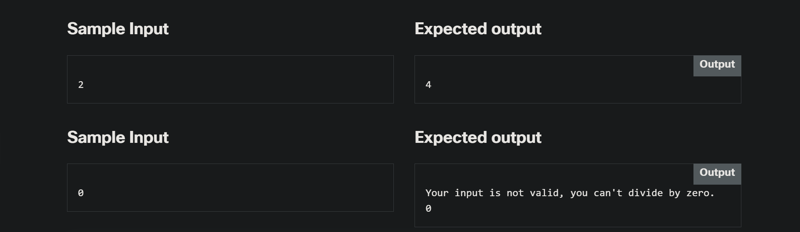

<!-- Custom stylesheet -->
<link rel="stylesheet" href="../../_css/main.css">

<!-- Site logo -->


> [🏚️ README](../../../README.md) | [📁 Courses](../../index.md) | [📚 Vocabulary](../../Vocabulary.md) | [🗓️ Assignments Schedule](../Assignments_Schedule.md) | [🔖 Bookmark](#bookmark)


> CIS 251 - C++ Programming | (Fall 2026 · *Dr. Rosalyn Warren*)   
> 📝 Eric Hepperle's Notes on — **Cisco Netacad C++ Essentials 2** course   
>
> 🧠 CPPE1: Module 3: Exception Handling  

# 🧪 3.0.8   LAB   Exceptions: input validation

## Level of difficulty

Medium

## Objectives

Familiarize the student with:

*   situations when exceptions are thrown;
*   the handling of exceptions.

## Scenario

Improve this simple program so that it prints a message when the user inputs invalid data. Add code to throw the exception manually using the throw keyword when a user inputs 0.


## Starter Code

```cpp
#include <iostream>
using namespace std;
int main(void) {
	int a = 8, b = 0, c = 0;
	cin >> b;
	try {
		//Your code here
		c = a / b;
	}
	// Your code here
	cout << c << endl;
	return 0;
}
```

---

## Sample Input





## Sample Solution

```cpp
#include <iostream>
using namespace std;
const int DivideByZero = 111;
int main(void) {
	int a = 8, b = 0, c = 0;
	cin >> b;
	try {
		if (b == 0)
		{
			throw DivideByZero;
		}
		c = a / b;
	}
	catch(int ex)
	{
		if (ex==DivideByZero)
			cout << "Your input is not valid, you can't divide by zero." << endl;
	}
	
	cout << c << endl;
	return 0;
}
```

## Eric's Answer

```cpp
#include <iostream>
#include <string>
using namespace std;

int divTwoNums(int a, int b)
{
    if (b == 0)
        throw string("division by zero not allowed");
    return a / b;
}

int main(void)
{

    cout << "****************** LAB START *************\n";

    int a = 8, b = 0, c = 0;
    cin >> b;
    try
    {
        c = divTwoNums(a, b);
        cout << c << endl;
    }
    catch (string problem)
    {
        cout << "Exception caught: " << problem << endl;
    }

    cout << "****************** LAB END ***************\n";

    return 0;
}
```

## 🧠 LESSONS_LEARNED

### 🎯 1. Keep the solution within the lab’s scope

- The lab requires manually throwing an exception when the user enters `0` and printing an error message.
- Additional input validation is outside this lab’s scope.

### 🏷️ 2. The sample’s integer code is a choice—not a requirement

| Sample solution | My solution |
|---|---|
| Throws an integer error code. | Throws a string error message. |
| Uses `throw DivideByZero;`. | Uses `throw string("division by zero not allowed");`. |
| Handles it with `catch (int ex)`. | Handles it with `catch (string problem)`. |

In the sample:

```cpp
const int DivideByZero = 111;
```

- `111` is an arbitrary error code.
- `DivideByZero` gives the code a readable name.
- `const` prevents changing the constant.
- Only `throw DivideByZero;` actually throws the exception.

### 🔗 3. A called function can throw to its caller

My function detects the problem:

```cpp
if (b == 0)
    throw string("division by zero not allowed");
```

The handler in `main()` catches it because the function call occurs inside the `try` block:

```cpp
try
{
    c = divTwoNums(a, b);
    cout << c << endl;
}
```

The `throw` does not need to appear directly inside `main()`.

### 🛠️ 4. Use the function’s returned result

```cpp
c = divTwoNums(a, b);
```

My function handles both checking the divisor and calculating the quotient. Assigning its return value avoids discarding the result or repeating the division.

### 🚦 5. Print the quotient only after successful division

My result output is now inside `try`, immediately after the assignment:

```cpp
c = divTwoNums(a, b);
cout << c << endl;
```

| When the divisor is nonzero | When the divisor is zero |
|---|---|
| The function returns the quotient. | The function throws before dividing. |
| The assignment updates `c`. | The assignment does not complete. |
| The next statement prints `c`. | The output statement is skipped. |
| Execution continues after `try`/`catch`. | The handler prints the error, then execution continues after `try`/`catch`. |

This prevents printing the initial value of `c` as though it were a valid quotient.

### 🔒 6. Catching by value is valid; const reference is optional

My current handler:

```cpp
catch (string problem)
```

works with a separate string value.

The alternative:

```cpp
catch (const string& problem)
```

refers directly to the exception without allowing changes through that reference.

| Part | Meaning |
|---|---|
| `string` | The exception type to handle. |
| `&` | Refer to the exception instead of making a handler-local copy. |
| `const` | Prevent modification through the reference. |

Both forms can handle my thrown string. The reference binds to the exception object; I do not need to “throw a reference.”

### 📚 7. Include the header for the type I use

```cpp
#include <string>
```

My latest draft explicitly includes the header for `std::string`. `using namespace std;` lets me write `string`, but does not replace the header.

## 🔧 FUTURE IMPROVEMENTS — Within Lab Scope

- Optionally change the handler to `catch (const string& problem)`.
- Replace the sample-output placeholder with actual program output.
- Update the status comment to reflect that the integer error code is an alternative approach, not an unresolved requirement.
